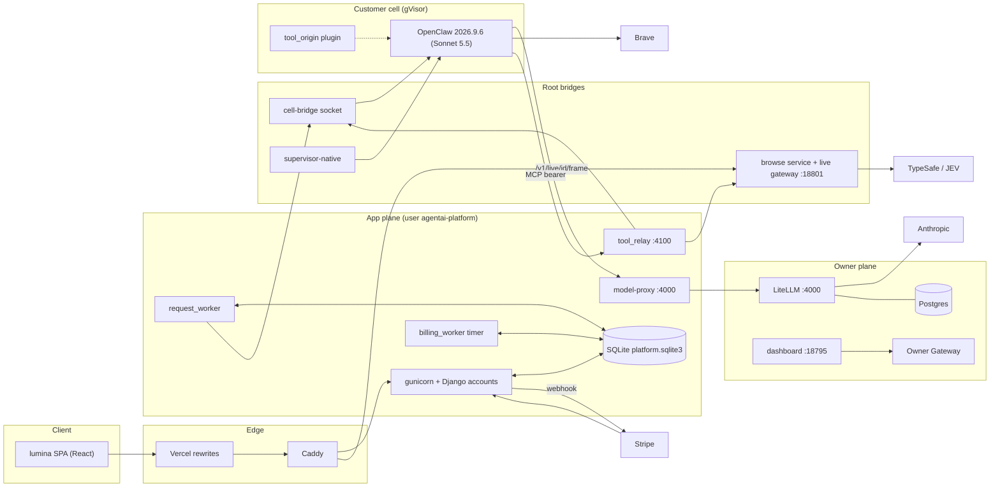
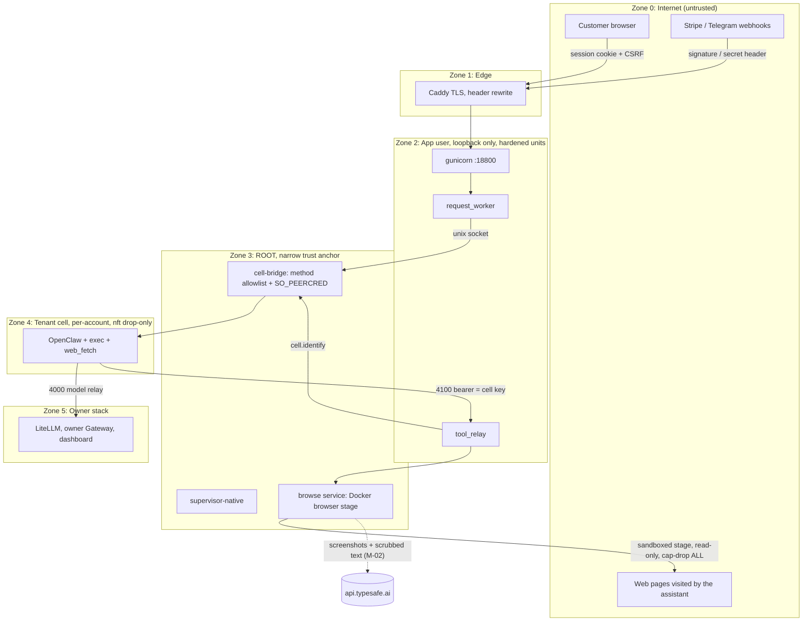

# Architecture (from code)

Branch `product-phases-6-11` @ `03662de` + uncommitted tool_origin work (IN PROGRESS). Production UNVERIFIED. Source of the agent loop: `_findings/orchestration.md` ("The real agent loop").

## 1. Layers

| Layer | Contents | Notes |
|---|---|---|
| L0 Edge | Vercel rewrites, Caddy (`Caddyfile.getlumina`) | Caddy overwrites client-IP header (M-04) |
| L1 Web | `lumina/` SPA, Django `/account/` pages | polling only, no SSE (FE-007) |
| L2 App | gunicorn + Django `accounts/` (1 sync worker), `BoundaryMiddleware`, `AccountMiddleware` | tenant from session only; uniform 404 on denial |
| L3 Services | `agentai_platform/*` (chat, queue, budget, billing, vault, genui, files) over SQLite | `AccountStore` adapts sqlite3 API to Django connection |
| L4 Workers | request-worker (serial), billing-worker (30 s timer), mail timer, lifecycle-worker | ONE global `request_slot` |
| L5 Root bridges | cell-bridge (unix socket), supervisor-native, browse service | root; allowlisted RPCs; SO_PEERCRED |
| L6 Tenant cells | gVisor container per customer on second Docker engine; OpenClaw 2026.9.6; Sonnet 5.5 | one active cell per host |
| L7 Relays | model-proxy 10.77.0.1:4000, tool-relay 10.77.0.1:4100 | only two doors from cell to host |
| L8 Owner plane | compose stack (Postgres, LiteLLM, owner Gateway), dashboard, `bin/` | separate from customer plane |

## 2. Wired vs only present in code

| Status | Items |
|---|---|
| Wired (called from entry points) | Chat send/steer/goal/plan, serial queue, `ChatDriver`, `NativeGateway`, cell bridge, tool relay, `lumina_browser`/`lumina_browser_step`, browse loop + safety floor + JEV ladder, live gateway, billing webhook + worker, files/tickets, genui documents, ops backup/monitor |
| Gated by owner switch (default off or unmet facts) | `customer_execution`, `browse_tasks`, `jev_routing` (shadow only, records), `jev_display`, `open_signups`, `billing_checkout`, `connectors_linking`, `credentialed_browsing`, `upload_limits`/uploads |
| Built, rollout-gated | Native browser engine `native_runner.py` (per account via `/etc/agentai-supervisor/browse-engine.json`, default `runner`) |
| In progress, uncommitted | tool_origin protocol 2 (`tool_origin*.py`, plugin, `cell_config`, `cell_bridge`, `tool_relay`); docs claim deployed 2026-10-28 (AG-006) |
| Present, not wired (no non-test importer) | `durable`, `memory`, `schedules`, `watchers`, `skills`, `optimization` (OptimizationGate), `policy_check`, `genui/intent`, `ops/rotation`, `lifecycle/broker` (operator check only) (M-05) |
| Wired but ineffective | `browser_optimization` switch (does not govern live TypeSafe egress, M-02/AG-003); `GoalChain.limit` unused (AG-015); `PARK_LIMIT` expiry loops (AG-005); SSE `/stream` built, unused, DoS risk (BE-002) |
| Deleted but still documented | `ServiceRouter`, `routing/services.py` (M-11) |
| Broken in prod wiring | Telegram completion path (BE-007); connector OAuth link (BE-008) |

Models: one assistant model per cell, `litellm/claude-sonnet-5-5` (`cell_config.py:18`); Haiku 4.5 and Sonnet 4.6 allowed but never selected. No per-request model router. JEV (TypeSafe) only as browser step chooser, optional shadow classifier, optional display chooser.

## 3. Component diagram



## 4. Trust-boundary and process diagram



Key boundary facts (from code; prod unverified):
- Tenant identity always derived from the session (`customer_scope`), never from the request; `BoundaryMiddleware` rejects `account/tenant/session/deployment_id` params (BE tenant-isolation result).
- Root units are the designed trust anchor but lack `ProtectSystem/ProtectHome/PrivateTmp` (IS-013).
- Cell has `sandbox.mode off`, `exec`, `web_fetch`; only `ask_user` and native `browser` are denied (AG-021). The "never press a payment button" guarantee exists only inside `lumina_browser` (`browse/loop.py:162-196`).
- Tool-origin proof is a defense against misattribution between runs, not against a hostile cell (AG-019).
- Data leaving the host: model prompts to Anthropic (via LiteLLM), Brave queries, TypeSafe (text scrubbed; screenshots NOT scrubbed, M-02), Stripe, Telegram, SMTP (off).

## 5. Data stores

| Store | Location (intended) | Contents |
|---|---|---|
| Customer app DB | `/var/lib/agentai-platform/platform.sqlite3` (0700 dir) | accounts, queue, reservations, tasks, messages, blocks, artifacts metadata, billing inbox, vault rows (AES-GCM) |
| Artifact files | `AGENTAI_STORAGE_DIR` | uploads, artifact versions |
| Cell volumes | `/var/lib/agentai-fleet/.openclaw/fleet/cells/<tenant>` | OpenClaw session (conversation context lives here) |
| Browse jobs | `/var/lib/agentai-browse/jobs` | screenshots, 24 h retention; `0o777` out dir (OP-011 #10) |
| Switch files | `/opt/openclaw-production/feature-switches/switches.json`, `safety-switches.json` | owner switch state (re-read each call, BE-020) |
| Owner Postgres | compose `budget-data` network | LiteLLM budgets/keys |
| Backups | `/var/backups/agentai` age-encrypted; owner pulls via `bin/pull-backups.py` | offsite default false (IS-016) |
| Browse job table | in memory of browse service | lost on restart; never evicted (AG-011) |

## 6. Request lifecycle (chat send to reply)

```mermaid
sequenceDiagram
  participant UI as SPA
  participant API as accounts/chat.py:166
  participant CS as ChatService.send chat.py:203
  participant Q as RequestQueue request_queue.py
  participant L as BudgetLedger budget.py
  participant W as request_worker.py
  participant D as ChatDriver chat_driver.py
  participant GW as NativeGateway gateway.py
  participant BR as CellBridge cell_bridge.py
  participant OC as OpenClaw in cell
  UI->>API: POST /v1/conversations/id/send
  API->>CS: send
  CS->>Q: submit (state waiting) request_queue.py:61
  CS->>L: admit (reservation + task queued) chat.py:243-250
  loop every 3 s
    W->>Q: claim oldest waiting, lease 120 s (request_queue.py:147)
  end
  W->>D: execute chat_driver.py:141
  D->>GW: send (idempotency key = run id)
  GW->>BR: unix socket dispatch
  BR->>OC: chat.send via docker exec relay
  loop until ok / Stop / budget / 900 s
    D->>GW: wait 3 s + history, mirror rows to chat_messages
  end
  D->>D: finish: files, genui, outcome.judge
  D->>L: settle (LiteLLM spend delta)
  D->>Q: finish (release slot); GoalChain.tick may chain
  UI->>API: poll /v1/conversations/id/messages (2.5 s)
```

Failure edges worth knowing: cancel of a WAITING request never settles its reservation (M-01); a send is committed claimable before `admit` runs (BE-006); budget guard fails open on LiteLLM snapshot errors (AG-007); outage tolerance 90 s; uncertain claims reconciled, abandoned 1800 s after creation not after uncertainty (BE-009).

## 7. Processes and units (intended)

| Unit | User | Entry |
|---|---|---|
| `agentai-platform-app` | agentai-platform | `gunicorn -c deploy/gunicorn.conf.py accounts.wsgi` |
| `agentai-request-worker` | app | `manage.py request_worker` |
| `agentai-lifecycle-worker` | app | `lifecycle.worker_main` |
| `agentai-supervisor-native` (and legacy `agentai-supervisor`) | root | `lifecycle.supervisor_main` |
| `agentai-cell-bridge` | root | `lifecycle.cell_bridge_main` |
| `agentai-browse` | root | `browse.service_main` (+ live gateway thread :18801) |
| `agentai-tool-relay` | app | `manage.py tool_relay` (in progress) |
| `agentai-model-proxy`, `agentai-cells-docker`, `-cells-firewall` | various | `platform/deploy/{model-proxy,cells-docker}` |
| timers | | billing-worker 30 s, platform-mail 60 s, ops-backup 03:40 UTC, ops-monitor 5 min |
| not in repo | | `openclaw-dashboard.service`, `openclaw-ops-backup`, `agentai-browse.service.d/jev.conf` (IS-006) |
| `agentai-platform-control` | | LEGACY, port 18801 clash with live gateway (IS-004) |

## 8. Structural weak points (summary)

- Single lane everywhere: one request slot, one active cell, one browser stage, one sync gunicorn worker on SQLite (AG-004, BE-002, BE-013). Possible two-account stall (AG-004).
- Three browser designs coexist (M-08) and three generative-UI generations (M-07).
- Two migration systems and two task-limit sets (plan.json vs routing/config, OP-008 #10).
- Observability intentionally thin (django logger to NullHandler, M-12).
