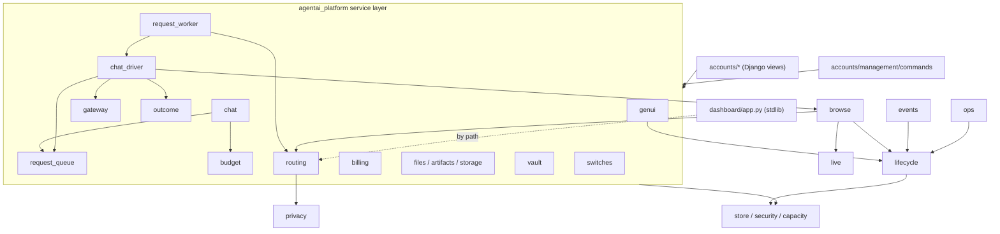

# Dependencies

Production UNVERIFIED. Internal graph computed read-only with a stdlib `ast` pass over `platform/agentai_platform` (package = first path component under `agentai_platform`; all import forms counted, including function-level). Earlier investigators produced a separate zero-importer list (BE-014, AG-009), which is merged here.

## 1. Internal module dependencies (package level)

Layering as actually imported (arrow = "imports"):

Package fan-out from the AST pass:

| Package | Imports (other packages) |
|---|---|
| `browse` | adapters, bridge_client, genui, lifecycle, live, privacy, routing, safety, saved, switches, vault |
| `lifecycle` | adapters, bridge_client, browse, capacity, events, genui, safety, security, store, switches |
| `routing` | genui, privacy |
| `genui` | lifecycle, security |
| `ops` | lifecycle |
| `live` | none |

### Cycles
- Package-level mutual edges exist between `browse` and `lifecycle`, `genui` and `lifecycle`, `events` and `lifecycle`. The upward edges are narrow: `lifecycle/worker_main.py:13` imports `EventService` (entry point), and the downward ones are `lifecycle.coordinator` / `lifecycle.types` (`Coordinator`, `identifier`, `Conflict`) imported by `browse/adapter.py:19`, `genui/artifacts.py:11-12`, `genui/store.py:7-8`, `genui/runner.py:12`, `events.py:17-18`. So `lifecycle` is both a low-level kernel (coordinator, types) and a high-level orchestrator (cell_bridge, worker). Not a runtime import cycle I could demonstrate (the lifecycle-to-browse/genui edges were not shown to be module-level), but the package boundary is muddy. Suggested split is a lead only (class E): move `coordinator`/`types` into a small kernel package.
- `routing` depends on `genui` (display chooser) which depends on `lifecycle`: JEV display code is reachable from the lifecycle kernel only through `genui`.

### Orphan clusters (no non-test importer; M-05)
`durable`, `memory`, `schedules`, `watchers`, `skills`, `optimization`, `policy_check`, `genui/intent`, `ops/rotation`; `lifecycle/broker` is imported only by `platform/deploy/p4_broker_check.py:10` and tests. They have tables (migrations 0010/0012...), routes returning 503 `capability_not_enabled`, and locked switches. Preserve (class C/G). Dormant by config: `config/skills`, `config/workspace-templates`, `config/phase*` (AG-009).

### Cleared as not orphans
`ops/probe_models.py`, `routing/bench.py`, `routing/report_cli.py` (called by `dashboard/app.py:1305`), `ops/cli.py`, `server.py`.

### Duplicated cross-cutting code (ST-011, AG-010, BE-024)
- SSRF / private-range policy in four places: `browse/runner.mjs`, `browse/native_runner.py:34-60`, `ssrf.py`, `lifecycle/netpolicy.py:18`.
- `AccountStore(...)` + service wiring repeated in about 12 view modules; `ChatService` factory re-implemented in `accounts/{chat,telegram,files,views}` and `telegram_worker` (BE-007 root cause).
- Two hand-rolled `.env` parsers (`bin/owner-console.py:45`, `deploy/release.py:40`); raw `sqlite3.connect` in 12 modules besides the ORM.

### Other graph facts
- Frontend: `lumina/src/lib/api.ts` is the only HTTP client (3 raw `fetch` exceptions, FE-006). `gen/` and `components/genui|lib/genui` both live; `BlockView -> Cards -> gen/legacy -> gen/Renderer` is a 3-hop chain (FE-004).
- Cross-process links not visible to static analysis: ChatDriver to browse service (unix socket), browse runner to live gateway (`live.jpg` file), cells to relays (HTTP). See ARCHITECTURE.
- `lumina-character` imports nothing from `lumina` and nothing imports it; its `node_modules` symlink points into `lumina/node_modules` (M-06).
- `jev-browser`, `jev-window-core` are unconnected to the platform (OP-004).

## 2. External dependencies: Python

| Manifest | Contents | Notes |
|---|---|---|
| `platform/requirements.lock` | Django 5.2.17, django-otp 1.7.3, gunicorn 26.2.0, cryptography 50.0.2, cffi, asgiref, sqlparse, packaging, pycparser; hash-pinned | no input file, so no upgrade source of truth; README wrongly says "pure-Python" (ST-015) |
| `requirements-local.txt` | `python-dotenv==1.2.3` | used by 5 `bin/*.py` |
| undeclared | `mcp` imported by `bin/phase6/authorize-google.py:12-13` | ST-006, README claim false |

Everything else is stdlib: control server, dashboard, TypeSafe/Stripe/Telegram clients (`urlopen`; only 5 files, no shared client, ST-011). CI uses Python 3.12, local venv 3.14. No linter, type checker or `pip-audit` is installed or run (ST scope, OP-009).

## 3. External dependencies: npm

| Package | Key deps | Notes |
|---|---|---|
| `lumina/package.json` | react 19.3.0, react-router-dom 7.18.4, vite 8.3.5, vitest 5.0.5, typescript 7.0.2, zod 4.6.7, mermaid 12.2.0, katex 0.19.1, three 0.186.1, @react-three/fiber 9.8.1, react-markdown ^10.1.0, remark-gfm ^4.0.1 | every declared dep is imported (FE-014); two caret ranges while the rest are exact (ST-007); chunk warning limit raised to 900 (large three/mermaid/katex chunks) |
| `lumina-character/package.json` | same family, older: zod 4.6.5, vite 8.3.1, vitest 5.0.2; no mermaid/katex | `tsc` ran against lumina's modules via symlink, so its own pins are untested (FE-001) |
| `browse/package.json` | `playwright-core 1.49.1` only | pinned to a late-2024 release; deliberate? (ST-007) |
| OpenClaw plugin (`lifecycle/tool_origin_plugin/`) | plain `.mjs`, test `platform/tests/tool_origin_plugin.test.mjs` | untracked, not in CI |
| `jev-browser/runner` | own Node CDP runner | unrelated to `browse/` |

No ESLint/Prettier in either frontend package (FE-013). `npm audit` was not run.

## 4. External dependencies: system and services

| Dependency | Used for | Where wired | Prod status |
|---|---|---|---|
| OpenClaw 2026.9.6 | Assistant runtime in each cell | image pin, `lifecycle/cell_config.py`; gateway RPC `gateway.py` | UNVERIFIED |
| LiteLLM + Postgres | Per-account virtual keys, budgets, model routing | `deploy/docker-compose.production.yml`, `config/litellm.example.yaml`, `litellm_admin.py` | UNVERIFIED |
| Anthropic | Model provider (Sonnet 5.5; Haiku 4.5, Sonnet 4.6 allowed) | via LiteLLM only | key held by owner stack |
| Docker + gVisor (`runsc`) | Cell isolation on second engine; browser stage containers | `platform/deploy/cells-docker/`, `browse/service.py:647-651` | UNVERIFIED |
| nftables + ufw | Cell egress policy | `lifecycle/netpolicy.py`, `agentai-cells-routes.sh` | stale sample (IS-005) |
| Caddy | TLS edge | `platform/deploy/caddy/Caddyfile.getlumina` | UNVERIFIED |
| Vercel | Static hosting + rewrites | `platform/deploy/vercel/` | UNVERIFIED |
| Stripe | Subscriptions | `agentai_platform/billing.py`; account not created (LAUNCH.md) | not live |
| Brave Search | `web_search` in cell | shared key in cell config | UNVERIFIED |
| TypeSafe / JEV (`api.typesafe.ai`) | Browser step chooser (text + screenshots), shadow classifier, display chooser | `browse/ladder.py`, `routing/*`, key file `AGENTAI_TYPESAFE_KEY_FILE` | M-02 |
| Telegram Bot API | Linking/ingress | `telegram.py`, `bin/activate-telegram.py` | incomplete (BE-007) |
| Google (Gmail, Calendar, Drive), GitHub | Connectors | `connectors.py`, `bin/phase6/authorize-google.py` | inert (BE-008) |
| SMTP | Account mail | `deliver_account_mail`; `AGENTAI_MAIL_ENABLED` off by default | unverified |
| age | Backup encryption | `ops/crypto.py`; missing on dev/CI so tests skip (ST-017) | |
| fail2ban, systemd, SQLite | host | units | |
| SonarQube | one-off scan 2026-10-13 | `sonarqube-export/` | not wired (OP-010) |

## 5. Declared-vs-used findings

| ID | Finding |
|---|---|
| ST-006 | `mcp` used, undeclared; README claim "only requirements-local.txt" false |
| ST-007 | Mixed exact/caret pins in `lumina`; `playwright-core 1.49.1` old; Python lock has no input file; third-party imports (Django, django_otp, gunicorn, cryptography) all match the lock |
| FE-014 | All `lumina` deps are used; fork lacks katex/mermaid to match older code; `three` example loaders import path not verified lazy |
| BE-015 / M-09 | Env vars: 8 documented, about 42 read; `AGENTAI_CARD_IMAGES` and `AGENTAI_BRAVE_IMAGE_KEY_FILE` documented but read by no code |
| ST-012 | vulture >=80%: unused imports `accounts/middleware.py:7`, `accounts/views.py:88`, `chat_driver.py:20`; unused vars `browse/service.py:146`, `lifecycle/profiles.py:38` (check test patch targets first) |
| AG-015 | `hmac` imported unused in `tool_relay.py:14`; `GoalChain.limit` stored, never read |
| FE-003 | Name-based unused exports in `lumina/src/gen/*` and `Icons.Plus` (leads, not proof) |
| IS-023 | Duplicate/dead deploy config: `deploy/litellm.yaml` (dup), `Caddyfile.example`, `agentai-supervisor.service`, `agentai_cells.nft.generated` |
| BE-012 | `safety_overrides`, `safety_access` tables exist only in Django migrations 0014/0015, not in SQL migrations |

## 6. Supply-chain hygiene summary

- Good: hash-pinned Python lock, exact npm pins, digest-pinned compose images, no secret shapes in tracked files or history scans (IS-018, GH-010; limits: unprefixed secrets not covered).
- Gaps: no automated dependency/CVE scanning; CI skips frontend entirely (M-10); no lint step.
