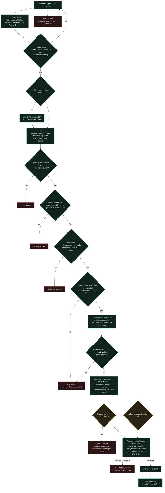
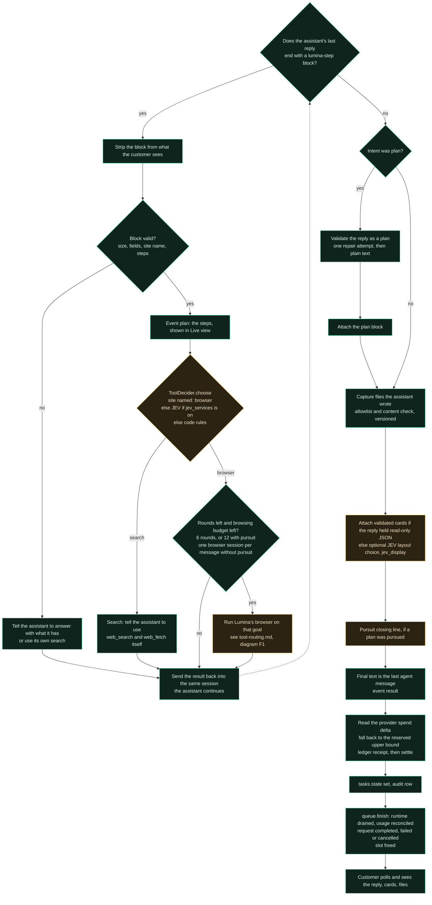
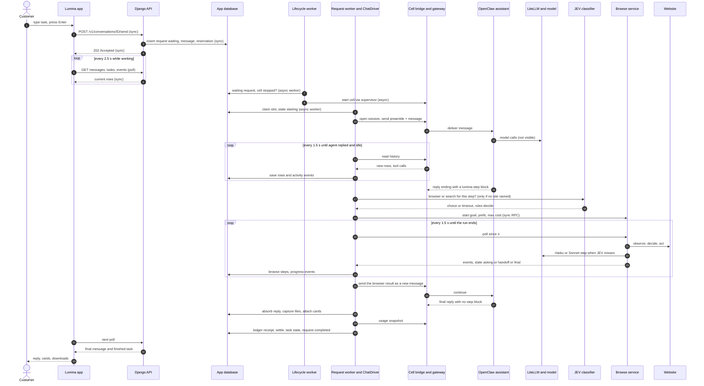

# Agent execution: request flow and sequence (Diagrams B and C)

> **Historical.** This page describes the code before the move to native OpenClaw execution (26 Oct 2026): the `lumina-step` protocol, JEV tool choice, Pursuit, the
> round loop and transcript polling no longer exist. The current description is [native-execution.md](native-execution.md). Kept for the record.

The full journey is split into three flowcharts so each stays readable, followed by the sequence diagram and a stage-by-stage table. Legend: see [README.md](README.md#legend-used-in-every-diagram).

## B1. From prompt to a queued, funded request

**What happens.** The browser sends one JSON call. The server authenticates it, rate-limits it, validates the fields, records the message and a `waiting` request, then reserves the budget. Only after the reservation does the request become eligible to run. Retrying with the same `key` returns the same request instead of creating a second one.

**Responsible code**
- Client: `lumina/src/components/Composer.tsx` (`submit`, the POST at line 67, `maxLength` from `app.limits.max_message_chars`, paste guard at line 82, disabled attach at line 84); `lumina/src/lib/api.ts:14-18` (CSRF).
- Server: `accounts/middleware.py:AccountMiddleware` (session, epoch, rate limits), `accounts/views.py:endpoint` (field allow-list and size), `accounts/views.py:customer`, `accounts/chat.py:chat_send` (line 162) → `service().send`, `agentai_platform/chat.py:ChatService.send` (line 224), `request_queue.py:RequestQueue.submit` (line 42), `budget.py:BudgetLedger.admit`.

**Endpoints, events, entities.** `POST /v1/conversations`, `POST /v1/conversations/<id>/send`. Event `task_queued`. Tables `customer_requests`, `chat_messages`, `tasks`, `task_reservations`, ledger entries, `audit`.

**Limits and gaps**
- There is **no per-hour task limit on `chat_send`**. `rate('task.create', ..., 30, 3600)` is applied in `chat_retry` (`accounts/chat.py:241`) and `POST /v1/requests` (`accounts/requests.py:25`) only. `platform/UI_CONTRACT.md` says 30 new tasks per hour. In practice a chat sender is limited by 30 writes per minute (middleware), 3 waiting requests, and the budget reservation. See [findings.md](findings.md).
- If the owner switch `customer_execution` is off, `service()` builds a `ChatService` with no pricer, so `send` returns the unfunded "waits" response (`chat.py:send`, the `CapabilityUnavailable` branch).

## B2. Waking the workspace, claiming the request and driving the assistant

```mermaid
flowchart TD
  classDef impl fill:#10231c,stroke:#34d3a0,color:#d7f5ea
  classDef gated fill:#2a2314,stroke:#f5b942,color:#f5e6c0
  classDef ext fill:#1f1a33,stroke:#a78bfa,color:#e0d6fa
  classDef bad fill:#2a1616,stroke:#ef6a6a,color:#f5d0d0

  W0["Lifecycle worker tick<br/>looks for stopped cells with a waiting<br/>non-browse request"]:::gated
  W1["Queue a system start for that account<br/>event: Waking your assistant"]:::gated
  W2{"Another account's cell is running?"}:::gated
  W3["Wait, or stop the other cell if it is idle<br/>15 min, nothing running, queued or awaiting approval"]:::gated
  W4["Supervisor starts the cell<br/>receipt checked against the fleet registry"]:::gated
  R0["Request worker tick every 3 s<br/>only if customer_execution is on"]:::gated
  R1{"A request stuck uncertain?"}:::impl
  R2["Reconcile from the cell transcript<br/>or abandon after 30 min"]:::impl
  R3["claim: oldest waiting, not paused<br/>cell active for that account<br/>state starting, fence token, 120 s lease"]:::impl
  R4{"Active reservation?"}:::impl
  R5["Fail now, nothing charged"]:::bad
  R6["Shadow router classifies beside the real path<br/>jev_routing, never changes anything"]:::gated
  D0["ChatDriver.execute"]:::impl
  D1{"Gateway can send and read history?<br/>reservation active?<br/>cancel already requested?"}:::impl
  D2["Close as cancelled before any effect"]:::bad
  D3{"Intent"}:::impl
  D4["Browse: run the browser directly,<br/>its result is the reply"]:::gated
  D5["Build the outgoing text<br/>plan prompt, execute or phase prompt,<br/>or the plain message"]:::impl
  D6{"Plain typed chat and not Text mode?"}:::impl
  D7["Prefix the assistant preamble<br/>how to plan, when to ask, how to request a tool,<br/>what the customer asked Lumina to remember"]:::impl
  D8["Open or reuse the cell session<br/>send the message, record delivery acknowledged"]:::impl
  CELL["OpenClaw assistant<br/>reads, plans, answers, may use its own tools"]:::ext
  D9["Poll the transcript every 1.5 s<br/>activity events, agent rows saved,<br/>cancel checked, lease renewed"]:::impl
  D10{"Agent replied and runtime idle<br/>twice in a row?"}:::impl
  D11{"Run past 900 s?"}:::impl
  D12["Abort, close as failed"]:::bad

  W0 --> W1 --> W2
  W2 -- no --> W4
  W2 -- yes --> W3 --> W4
  R0 --> R1
  R1 -- yes --> R2 --> R1
  R1 -- no --> R3
  W4 -.-> R3
  R3 --> R4
  R4 -- no --> R5
  R4 -- yes --> R6 --> D0 --> D1
  D1 -- cancelled --> D2
  D1 -- ok --> D3
  D3 -- browse --> D4
  D3 -- chat or plan or phase --> D5 --> D6
  D6 -- yes --> D7 --> D8
  D6 -- no --> D8
  D8 --> CELL
  D8 --> D9
  CELL -.-> D9
  D9 --> D10
  D10 -- no --> D11
  D11 -- no --> D9
  D11 -- yes --> D12
```

**What happens.** A separate worker notices a sleeping workspace and starts it. The request worker takes the single global slot, confirms the request is funded, then hands the message to the assistant through the bridge. From then on Lumina only watches: it re-reads the assistant's transcript every 1.5 seconds and mirrors new rows and tool calls into its own tables.

**Control.** Application code decides wake-up, claiming, funding and timeouts. The assistant's model decides what to answer and which of its own tools to use. The customer decides cancel, pause and retry.

**Responsible code:** `lifecycle/worker.py:enqueue_wakes` (98), `lifecycle/sleep.py:wake_plan` (33), `can_sleep` (25); `request_worker.py:RequestWorker._tick`; `request_queue.py:claim` (126), `heartbeat` (162); `chat.py:ChatDriver.execute` (584), `_agentic` (873), `_poll` (1300); `agent_protocol.py:preamble` (163); `genui/runtime.py:outgoing` (50).

**Entities.** `customer_requests` (state, fence, lease_owner, lease_until, cancel_requested, paused, retry_of, intent, context_json), `request_slot` (one row), `lifecycle_slot`, `chat_deliveries` (attempt, state, native_run_id, usage_before_microusd), `conversations.native_session_ref`, `events`.

**Limits.** Poll interval 1.5 s, run timeout 900 s, settle after 2 idle reads (`chat.py:41`, `ChatDriver.__init__` at 431). One request runs at a time across all customers (`request_slot`).

**Unknowns.** What the assistant does between "send" and its reply is inside OpenClaw. Lumina sees only transcript rows and tool-call activity items.

## B3. Tool steps, the loop, and delivery

**What happens.** After each assistant reply Lumina looks for a fenced `lumina-step` block. It is the only way the assistant can ask Lumina for something. If there is one, Lumina validates it, picks browser or search, runs the browser if needed, and sends the outcome back as a new message in the same session. The loop ends when the assistant replies without a step, the round limit is reached, the budget share is used, the run times out, or the customer cancels. Then files and cards are attached, spend is reconciled, and the last agent message becomes the result.

**Control.** The assistant model decides whether to ask for a step. Code decides whether the step is valid, which tool runs and how many rounds are allowed. A web page cannot widen what the browser may do.

**Responsible code:** `agent_protocol.py:split`, `clean`, `browser_goal` (136), `result_message` (201), `replan_message` (221); `routing/tools.py:ToolDecider.choose` (68); `chat.py:_answer_step` (897), `_pursue_step` (963), `_browse_for_assistant` (1138), `_capture_files` (1242), `_choose_display` (1090), `_close_pursuit` (1102), `_reconcile_usage` (521), `_close` (559); `request_queue.py:finish` (172).

**Entities and events.** Events `plan`, `progress`, `activity`, `artifact`, `result`, `error`. Tables `ui_blocks`, `artifacts`, `task_reservations`, ledger receipts, `pursuit` rows, `browse_runs`.

**Gaps.** `MAX_STEP_ROUNDS` is described in the source comment as "tool requests answered in one message; one browser session of them at most". Nothing in this loop evaluates whether the assistant's final answer is correct. With `pursuit` on, a verification level is recorded (`pursuit.py:VERIFY_LEVEL`) but it is the assistant and a fixed list of closing lines, not an independent check of the result.

## C. Request sequence (an ordinary chat that needs one browser session)

**Reading the sequence.** The only synchronous customer-facing call is the send. Everything after it is asynchronous work in workers; the app learns about it by polling the database through the API. The streamed channel (`/v1/tasks/<id>/stream`) exists on the server but this client does not use it. Calls into the cell and the browse service are request/response with polling for completion.

**Evidence:** `chat.py:execute` (584-741), `chat.py:_poll` (1300), `chat.py:_run_browse` (776), `browse/client.py:BrowseRpc`, `lumina/src/pages/Chat.tsx:56`.

## The 15 requested stages, as the code actually does them

| # | Stage | What exists | Who decides | Evidence |
|---|---|---|---|---|
| 1 | Prompt, modes, tools, attachments | Textarea; **Respond** menu (Auto, Text, Plan, Browse) changes the request; **Tools** menu and Home tiles only pre-fill text; attachments disabled | Customer | `Composer.tsx:8,57,67,82,84`; `Home.tsx:38` |
| 2 | Frontend validation and submit | Not empty, `maxLength`, busy lock, client UUID idempotency key reused for an identical retry, CSRF token | App code | `Composer.tsx` `submit`; `lib/api.ts:14` |
| 3 | Auth, authorization, quotas, rate limits | Session and epoch check, account membership, CSRF, anonymous and per-user rate limits, queue cap of 3, budget admission. **No hourly task cap on chat send** | App code | `middleware.py:44-66`; `request_queue.py:54`; `budget.py:admit` |
| 4 | Conversation and task creation | Conversation created lazily by the client; request, message, task and reservation rows created at send | App code | `chat.py:224`, `request_queue.py:42`, `budget.py:84` |
| 5 | Context assembly | The assistant keeps its own history in its session. Lumina sends only the new message, prefixed with the preamble. For a **new session or a browser job** it also injects up to 20 earlier messages (12 000 chars, 3 000 per message). Saved choices and vault item **names** are listed in the preamble. **No file or retrieval context, no Lumina-side memory** | App code | `genui/runtime.py:30-48`; `chat.py:_known_about` (885); `agent_protocol.py:163` |
| 6 | Model selection and instructions | Lumina does **not** pick the assistant's model per request. The cell is provisioned with `litellm/claude-sonnet-5-5` (allow-list also Sonnet 4.6, Haiku 4.5). Browser steps use JEV, then `claude-haiku-4-5`, then `claude-sonnet-5-5`. Instructions are the preamble, the plan prompts, or none (Text mode) | Provisioning code; browse ladder | `lifecycle/cell_config.py:15-16`; `browse/llm.py:7`; `browse/ladder.py:1-12` |
| 7 | Answer, clarify, plan or use tools | Decided by the assistant's model, steered by the preamble. Code forces the plan path only if the customer chose Plan | Model, with customer mode | `agent_protocol.py:163`; `chat.py:224` (`kind`) |
| 8 | Tool selection and inputs | Two layers: the assistant's own tools inside the cell (not visible), and Lumina's `lumina-step` request, which becomes **browser** or **search** | Model asks; code validates and chooses | `agent_protocol.py:44` (`clean`); `routing/tools.py:68` |
| 9 | Permission and approval | Browser code rules (payment, sign-in, human check, denied domains); plan phases with `requiresApproval`; saved login or card needs customer approval each time. **No approval flow exists for the assistant's own tools** | Code and customer | `browse/loop.py:54,152-173`; `genui/runner.py:91-95` |
| 10 | Execution | Direct to the cell for chat and its tools; browse service for the browser; one request per plan phase via the queue | Workers | `chat.py:execute`; `genui/runner.py:PlanRunner` |
| 11 | Results return to the agent | Browser result is sent as a new message in the same session; search results stay inside the assistant's own turn | App code | `chat.py:_answer_step`; `agent_protocol.py:result_message` |
| 12 | Evaluate, continue, retry, ask, stop | The assistant model decides. Code caps rounds (6 or 12), time (900 s), browser steps (25 and 600 s) and spend. Pursuit adds a stored plan, verification and re-plan prompts | Model within code limits | `chat.py:41-44,431`; `browse/loop.py:79`; `pursuit.py` |
| 13 | Progress to the frontend | `events` rows (allow-listed kinds), mirrored transcript rows, browse steps, live frames. Delivered by **polling** | App code | `events.py:27`; `AgentThinking.tsx`; `Chat.tsx:56` |
| 14 | Persistence | See entities above; transcript mirrored; files versioned; spend settled | App code | `chat.py:_absorb`, `_capture_files`, `_close` |
| 15 | Final delivery and status | Last agent message becomes the result; request ends `completed`, `failed` or `cancelled`; no "partially complete" state exists except in the pursuit record | App code | `chat.py:_close` (559); `request_queue.py:finish` (172) |

## Loop controls and safeguards (present, absent, uncertain)

| Control | Status | Evidence |
|---|---|---|
| Orchestration entry point | Present: `ChatDriver.execute`, called only by `RequestWorker._tick` | `chat.py:584`; `request_worker.py` |
| Model invocation and tool-call parsing | The assistant's model call is inside OpenClaw (not visible). Lumina parses one fenced block with `agent_protocol.FENCE`; the last block wins | `agent_protocol.py:19,32` (`FENCE`, `split`) |
| Tool registration and dispatch | Lumina registers exactly two tools via `PLAN_TOOLS = ('browser','search','user','answer')`. The assistant's own registry is not visible | `agent_protocol.py:23`; `routing/tools.py:21` (`TOOLS`) |
| Sequential or parallel tools | Sequential. One step at a time; one browser session at a time on the host (`browse/service.py` slot); one request at a time across all customers | `request_queue.py:claim`; `browse/service.py:537` |
| Context updates between iterations | Browser result and search nudges are sent as new messages in the same session | `chat.py:_answer_step` |
| Result validation and outcome verification | Browser: code rules before and after a model reply, a reviewer (`browse/review.py`). Chat answer: none beyond plan schema validation. Pursuit: advisory verification levels only | `browse/loop.py`; `genui/schema.py`; `pursuit.py:17` |
| Completion conditions | Agent replied and runtime idle twice (`SETTLE_POLLS = 2`) | `chat.py:41` |
| Max iterations | 6 rounds; 12 with pursuit (env `AGENTAI_PURSUIT_MAX_ROUNDS`); browser 25 steps | `chat.py:42-43`; `browse/loop.py:79` |
| Timeouts | 900 s run, 600 s browser, 8 s JEV tool choice, 60 s unreachable browse service, 1800 s abandon an uncertain request, 120 s lease | `chat.py:431,44`; `browse/loop.py:79`; `routing/tools.py:29` (`DEADLINE_S`); `request_worker.py` |
| Token limits | Assistant model `maxTokens` 8192 (Sonnet 5.5) and 4096 (Haiku, Sonnet 4.6) in cell config; browser calls `max_tokens` 600 | `cell_config.py:27-29`; `browse/llm.py:27` |
| Spending limits | Reservation at admission; browse share capped at 60% of the task budget under pursuit; each paid browser call admitted against the cap; account and service allowances | `budget.py:admit`; `chat.py:_pursue_step`; `browse/ladder.py` |
| Retry and duplicate prevention | Idempotency key; fence token and lease; a delivery whose outcome is unknown is never resent; `Retry` creates a new request with `retry_of` | `request_queue.py:42,126`; `chat.py:671` (delivery marked uncertain), `chat.py:405` (`retry`) |
| Cancellation | Waiting: immediate `cancelled`. Running: `cancel_requested` flag read each poll, then `gateway.abort` or `rpc('cancel')` | `request_queue.py:86`; `chat.py:_poll`, `_run_browse` |
| Follow-up messages while running | Accepted; queued behind the running request (max 3 waiting) and run later in the same chat session | `request_queue.py:54`; `Composer.tsx` hint text |
| Approval pause and resume | Plan phases: `awaiting_approval` until approved. Browser: `asking`, `paused`, `handoff` with customer answer or takeover. Assistant tools: none | `genui/runner.py:91`; `browse/loop.py:456` |
| Refresh or disconnect | The client is stateless; state is in the database and re-polled | `Chat.tsx` load functions |
| Worker restart | Lease expiry marks the request `uncertain`; next tick reconciles from the cell transcript, or abandons after 30 minutes | `request_queue.py:126-132`; `request_worker.py:_tick`; `chat.py:reconcile` (1361), `abandon` (1347) |
| Tool-output security | `neutralize` strips text aimed at the AI; assistant step fields bounded and neutralised; secrets typed in Live view are masked and not stored; `privacy.scrub` before JEV | `browse/untrusted.py`; `agent_protocol.py:clean`; `routing/tools.py` imports `privacy.scrub` |

Not found: an independent check that the assistant's final answer matches the request; a hard wall-clock limit on a whole plan of phases (each phase is its own request with the 900 s limit); any limit on the assistant's own tool calls inside one run.
