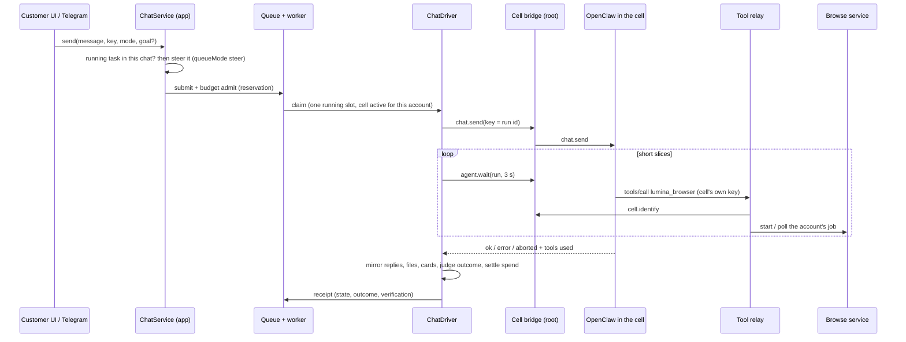
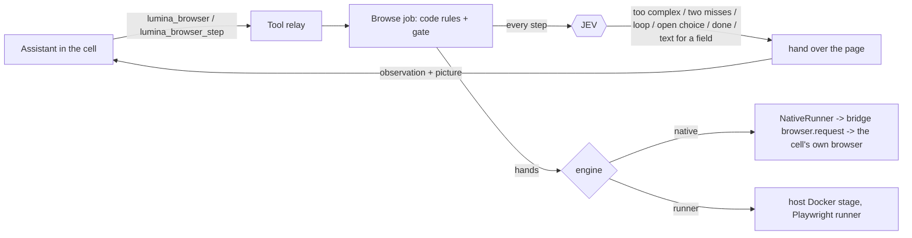

# Native execution: OpenClaw runs it, Lumina admits, supervises and settles it

Written 26 Oct 2026 after the migration off Lumina's own agent loop. This is the authoritative description of how a customer request is executed; the older pages in this folder
and in `../orchestration-audit/` describe the code before the migration and are kept as history.

Every statement about the runtime was checked against the installed OpenClaw **2026.9.6** (protocol 4): its bundled docs, its source, and real gateways driven by
`platform/tests/e2e/`.

## Who owns what

| OpenClaw owns | Lumina owns |
|---|---|
| model calls, native tool calls, tool-result continuation | authentication, customer isolation, request admission, the one running slot |
| the session and its run (`chat.send` key = run id) | infrastructure capacity, cell wake/sleep/handover |
| steering of an active run, Stop (`chat.abort`) | billing: reservations, spending limits, usage settlement |
| the goal (objective, status, complete/blocked) | product UI, transcript, cards, files and downloads |
| the end of a run (`agent.wait`) | the verdict shown to the customer (`outcome.py`) |
| restart recovery of a running turn | the browser's code rules, saved-login consent, Live view and takeover |

One execution owner per request: the runtime's run. Lumina never starts a second loop and never turns assistant prose into a command.

## The path of one request

1. **Admission** (`ChatService.send`, `RequestQueue`, `BudgetLedger`): unchanged rules. A message sent while a task of the same chat runs becomes a steer of that run instead.
2. **Claim**: the account must hold the active cell; an account with a parked request waits (one execution per account, one session lane).
3. **Hand-over** (`chat_driver._begin`): nothing else may own the session's run (an unowned run is stopped, a live request's run defers this one). The input is recorded as a
   delivery (`chat_deliveries`, key `<request>-a<n>`) and sent. The key is the run id, so a resend after a crash cannot start a second run.
4. **Supervision**: `agent.wait` in 3 s slices. Between slices: Stop, the lease heartbeat, the spending limit (a run that has spent its reservation is stopped), the 900 s per-run
   limit (the runtime also has a 1200 s backstop in the cell config), a person the run waits for, and display progress copied from the transcript (never completion).
5. **Close** (`close_gate`, then `_finish`): replies attributed by the input they follow, files saved, cards attached, outcome judged, usage settled, then the slot is released.

## Tools

| Tool | Where it comes from |
|---|---|
| web search / fetch, files, commands | the runtime's own tools in the cell (Brave plugin as before) |
| `lumina_browser` | Lumina's sandboxed browser, served to the cell over MCP by `tool_relay.py` |
| `ask_user`, the runtime's `browser` | **denied** in every cell (`tools.deny`): `ask_user` needs a verified user profile the bridge's connection does not have; the native browser has none of the safety stops below |

## The browser: hands and brain

The runtime's own `browser` tool stays denied in every cell: it has no code-enforced payment or sign-in stop, no consent before a saved login or card is used, no human-check hand-off
and no stage the customer can watch and take over. Those live in Lumina's browse loop (`browse/loop.py`), which therefore stays the brain's gate. What changed is who moves the mouse and
who decides the hard steps:

- **Brain.** JEV decides each step first (a cheap call that can only pick from lists code built). When it cannot, the job hands the page to the assistant: `lumina_browser` returns "needs your next
  step" with the page's numbered controls, its text and a picture of the window; the assistant answers with `lumina_browser_step` (click/type/select by number, press, scroll, back, wait, ask,
  done, stop). Two kinds of hand-over: *for good* (JEV called it too complex, missed twice in a row, or the run is looping) and *for one step* (JEV chose a field but the request gives no text,
  JEV says the goal is done and the assistant confirms and writes the answer, or the page offers a choice the request leaves open). There are no Haiku or Sonnet tiers; the browse service
  calls no model but JEV. Every step of either decider passes the same code rules (payment page, sign-in page, human check, sensitive controls, denied sites, repeat/loop limits); the
  assistant cannot press a payment or order button.
- **Hands.** Two engines behind one interface (`Session`: open / snapshot / act / probe / view / screenshot / takeover). `runner` is the host's Docker Chromium stage. `native` answers the same
  commands over the cell bridge's `browser.request`, which needs `operator.admin` on the cell gateway (measured), so the bridge keeps a second, admin-scoped connection that only the browse service
  (root) may use, accepts only a fixed list of routes, forces the cell's own profile, and runs only page scripts it knows by name (`browse/native_scripts.py`): a caller can never send its own
  script to a customer's browser. Pictures come back as bytes read inside the cell by the relay program; the Live view's frames come from the cell browser's screencast, kept to the newest frame
  and only while someone watches.
- **Choosing the engine.** Per account, at job start, from `browse-engine.json` (see `platform/OPERATIONS.md`). Recorded on the job; never switched mid-job; no silent fallback.
- **Cost.** JEV's calls are the only browse-service model cost. The assistant's own steps are the cell's model usage, on the request's key and reservation like any other assistant work, and the
  60%-of-reservation cap on the browser tool still bounds the JEV part. The assistant waits at most 3 minutes between steps before the job is ended.

## People, Stop, steering, goals

- **Waiting for a person** (browser question, customer driving): the request is *parked* — `parked_reason` set, `request_slot` released, `tasks.state = waiting_for_approval` so the cell
  is not slept under it. The worker looks at parked requests every tick: still waiting / ready (takes the slot back) / ended (closed without the slot). Waiting time does not count
  against the run's deadline; a request parked 30 minutes is stopped.
- **Stop** aborts the session's runs, waits until the runtime confirms each owed run is over, stops the browser jobs, pauses the goal natively and closes as `cancelled`. If the
  runtime cannot confirm, the request stays `uncertain` and is retried; it is never reported cancelled on a guess.
- **Steer**: the message joins the running request (own `steer` delivery). The close gate refuses a steer after the last run ended, so no run is ever started that nobody owns.
- **Keep working until complete**: a native goal. The runtime 2026.9.6 does not start the next turn itself, so `goals.GoalChain` admits each next turn as its own request while the
  goal is `active`. Every turn is funded and limited like any task; Stop pauses the goal; a refused admission pauses it and says so; paused, blocked, budget-limited and
  complete goals are never continued; at most `GOAL_CHAIN_LIMIT` (20) turns per goal. Between turns the slot is free for other customers.
- **Plan phases** are unchanged product behavior: each phase is a request, approvals are states, and every phase runs as its own native run.

## Outcomes

`state` (waiting, starting, running, uncertain, completed, failed, cancelled) says whether the run is over. `outcome` says what it meant: **completed**, **partial** (the browser
stopped where the customer must act, the goal is held, the spending limit was reached), **blocked**, **failed**, **cancelled**. `verification` says whether anything Lumina can check supports
"done": **verified** (a cart page plus a click that added to it; a saved file), **unverified**, **not_applicable**. The assistant's own words are never evidence. The trailing sentence
added to a reply for a task that did not simply succeed comes from a fixed vocabulary.

## Identities

customer (account, actor) → conversation → native session key → request → delivery (`<request>-a<n>`, steer `<request>-s-<hash>`, restart hand-over `….r<epoch>`) = native run id →
tool calls (`successfulToolNames` on the run receipt) → browser jobs (`browse_runs`, `browse_sessions`) → events, artifacts (`task_id`), provider receipts (`task_id`).

## Failure and restart behavior (measured on real gateways)

| Event | What happens |
|---|---|
| worker dies mid-run | request `uncertain`; next tick recovers it onto the same run; one run, one charge |
| cell killed and restarted mid-run | supervision waits up to 90 s; the accepted input comes back `interrupted` and is refused under its old key, so it is handed over again under a fresh key; one run, one charge |
| cell unreachable longer | request left `uncertain`, recovered later; abandoned at its reserved cost after 30 minutes |
| duplicate send of a key | the runtime answers `ok`/`in_flight`; nothing new starts |
| Stop | aborted and confirmed; nothing arrives afterwards (checked for longer than the model's delay) |

## Validation

- `platform/tests/test_native_run.py`, `test_chat.py`, `test_request_worker.py`, `test_gateway.py`, `test_cell_bridge.py`, `test_browser_tool.py`: the contract against a faithful double.
- `platform/tests/e2e/`: 16 scenarios against real OpenClaw 2026.9.6 gateways (one per customer), the real bridge and relay, Lumina's real queue, worker, driver and ledger; only the model
  and the host browse service are scripted. Ordinary answer, repeated send, browser tool (handoff and done), files, plan and phases, steering, Stop, worker crash, cell kill and restart,
  browser question parking, goal chain, customer isolation, credential refusal, and the exact cell config Lumina provisions.
- Run: `cd platform && PYTHONPATH=. .venv/bin/python -m unittest tests.e2e.test_native_e2e` (needs node and the pinned package; skipped otherwise).

## Not verified here

- The native browser engine on the real cell image under gVisor, its Chromium memory per cell, the Live view frame rate there, and the cost and quality of the assistant driving pages (see the
  browser chapter in `platform/OPERATIONS.md`). On a developer machine it passes real-browser tests (gateway, bridge, relay, Chrome): `platform/tests/e2e/test_native_browser.py`.
- A real model: tool choice, cost and quality of the assistant driving the tools. The scripted model proves the plumbing, not the judgment.
- Real cells (gVisor, docker exec relay, the cell network and the 4100 firewall rule), the real LiteLLM spend feed, and the real browse service with Chromium.
- The Telegram path end to end (unit tests only).
- Upgrading cells already running: they take the new config at their next start.
