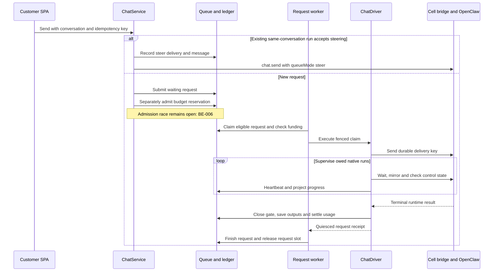
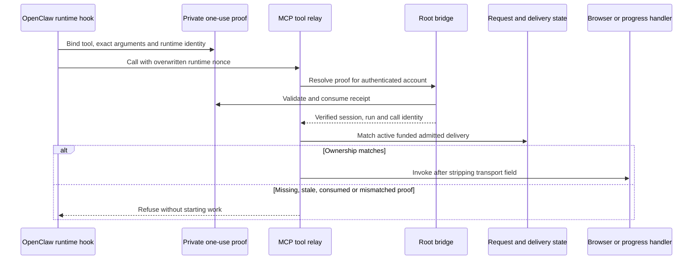
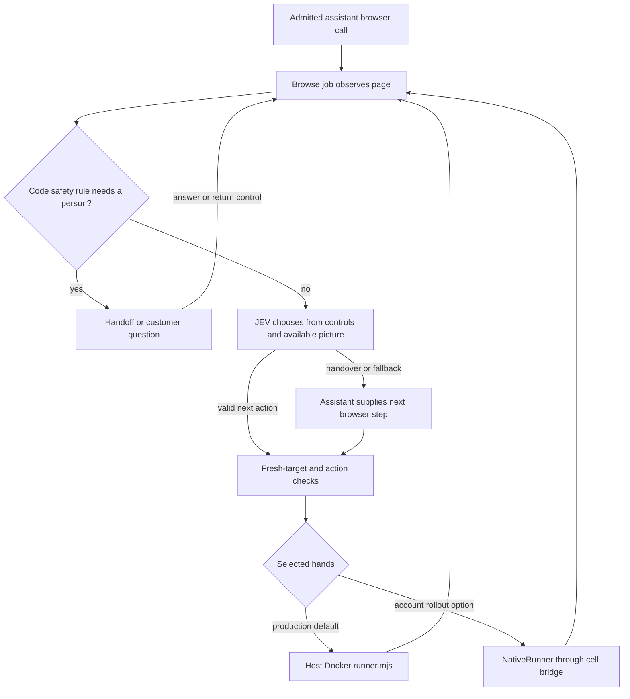

# Current execution: admission, runtime, browser and tools

Rebuilt 29 October 2026 from the checked-in source at `8c10824` and the
verified deployment record. This is a code/documentation inspection, not a new
runtime acceptance test or server inspection. Last verified platform release:
`20261030T022448Z-webhook-0c48ade`, source `0c48ade`; supervisor remained on
`20261028T212308Z-tool-origin-v2`. See the [deployment evidence](../../../docs/codebase-audit/DEPLOYMENT_2026-10-29.md).

## Ownership

OpenClaw owns the assistant loop, session runs, model calls and native tools.
Lumina owns whether a request is admitted, its account/cell binding, the global
request slot, supervision, its browser service, customer-facing projections
and usage settlement. The deleted `ServiceRouter`, Pursuit and `lumina-step`
architecture are not on this path.

## Send, steer and run

Rendered: [native-execution-1.svg](svg/native-execution-1.svg).

- `accounts.chat.service()` supplies the customer pricer and gateway only when
  execution is enabled. `ChatService.send()` first attempts a steer for a live
  request in the same conversation; otherwise it submits a separate request.
- Submission and budget admission are currently separate transactions. A
  worker may observe the intervening request; no `admitting` field has been
  implemented. This diagram intentionally does not promise atomic admission.
- `RequestQueue.claim()` checks capacity, account/author eligibility, the
  request slot and cell ownership. The earliest waiting request can still
  block behind another account's cell; parking does not guarantee fairness.
- `RequestWorker._tick()` checks an active reservation before executing.
  `ChatDriver` records deliveries and supervises the native run. Resends and
  recovery use the delivery/run identity; model-written task IDs are not proof.
- The close path checks runtime quiescence, projects replies/files/cards,
  reconciles usage and produces a receipt. The queue refuses handoff while
  reservations remain active/uncertain. Open failure paths are in [findings](findings.md).

## Tool identity: protocol 2

Rendered: [native-execution-2.svg](svg/native-execution-2.svg).
The cell runtime is trusted to supply identity within its own account; this is
not protection against a compromised runtime forging its own files. The host
checks account isolation and current admission. Receipt validation rejects
redirected, malformed, expired, oversized or replayed proofs; it is independent
of transcript-write timing. Progress and browser calls use separate relay
concurrency lanes; browser work remains serialized per account.

See [browser-tool-ownership.md](../browser-tool-ownership.md) for deployment
coupling and the detailed protocol, and [task-progress verification](../../evidence/task-progress/README.md)
for the restored desktop/mobile evidence. Those screenshots are historical
verification, not screenshots captured during this documentation rebuild.

## Browser decision and action path

Rendered: [native-execution-3.svg](svg/native-execution-3.svg).

`BrowseService` owns jobs; `BrowseRunner` owns observe/decide/act and the code
policy; `Ladder` handles JEV decisions and assistant handovers. With no JEV
chooser configured the assistant path is used. An engine is selected per job,
not silently swapped mid-job. Public-address restrictions and action rules
are switch-aware; default-on rules do not imply an unchangeable global policy.

The assistant receives browser observations and can respond through
`lumina_browser_step`; no additional model tier inside the browse service is
required. Sign-in/payment/human-check handoffs and saved-data consent belong
to this browser path. They are not a universal authorization barrier for all
other runtime tools such as commands or web fetch.

The code can send JPEG screenshots to TypeSafe. Page-text scrubbing is a
separate switch and cannot scrub pixels. The owner explicitly left screenshot
behavior unchanged; this rebuild neither adds a privacy gate nor changes it.
Backend question/answer support exists, but the shipping SPA lacks the fork's
question/vault answer components; a diagram edge is not proof of a complete UI.

## Controls, continuations and limits

| Control | Implemented path and qualification |
|---|---|
| Stop while waiting | Queue marks the request cancelled; the reservation/task release bug remains open (M-01). Do not promise the allowance is immediately returned. |
| Stop after claim | Records cancel intent; driver abort/drain/settle handles a running request. A failed runtime check remains recoverable/uncertain. |
| Pause before start | `paused` flag on a waiting request; reservation/place are retained. This is not a separate request state. |
| Wait for a person | Request remains `running` with a parked reason; request slot is released while cell/reservation are retained. Park-expiry re-parking is an open bug (AG-005), not a verified hard stop. |
| Spend monitoring | Driver checks native usage against the reservation. Unreadable/missing snapshots currently return no over-budget signal (AG-007). |
| Goal continuation | Each next turn is a newly admitted request. The worker passes `settings.GOAL_CHAIN_LIMIT` into `ChatDriver`; that configured cap is wired. `GoalChain.limit` is still stored but not read by that class. |
| Plan phases | Existing block/plan-runner actions create normal requests; they are not a second assistant execution engine. |

## Source evidence

- [ChatService](../../platform/agentai_platform/chat.py): `send`, `steer`, `_spawn`, `cancel`.
- [BudgetLedger](../../platform/agentai_platform/budget.py): `admit`, `receipt`, `settle`.
- [RequestQueue](../../platform/agentai_platform/request_queue.py): `submit`, `claim`, `finish`, `park`, `unpark`, `recover`.
- [RequestWorker](../../platform/agentai_platform/request_worker.py): `_tick`, `_run`, `_settle_uncertain`, `_parked_tick`.
- [ChatDriver](../../platform/agentai_platform/chat_driver.py): `execute`, `_begin`, `_supervise`, `_over_budget`, `_close`, `check_parked`.
- [Worker composition](../../platform/accounts/management/commands/request_worker.py): `build_worker` supplies the configured goal-turn limit.
- [Tool relay](../../platform/agentai_platform/tool_relay.py): `Relay.handle`, `Relay._owner`;
  [proof reader](../../platform/agentai_platform/lifecycle/tool_origin.py): `inspect_origin`;
  [runtime hook](../../platform/agentai_platform/lifecycle/tool_origin_plugin/index.mjs).
- [Browse service](../../platform/agentai_platform/browse/service.py): `start`, `_ask_gate`, `answer`, `control`;
  [loop](../../platform/agentai_platform/browse/loop.py): `BrowseRunner`;
  [ladder](../../platform/agentai_platform/browse/ladder.py): `Ladder.decide`, `JevChooser`.

Next: [state and recovery](state-and-recovery.md), [current findings](findings.md).
