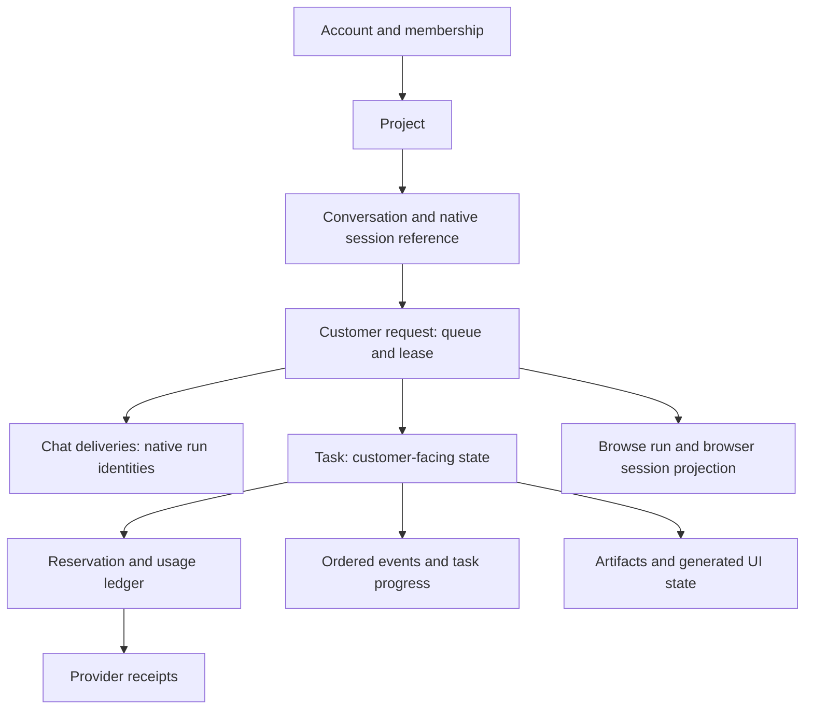
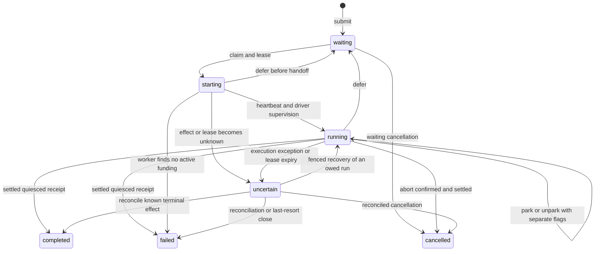

# Current state, persistence and recovery

Rebuilt 29 October 2026 from the checked-in source at `8c10824` and the
verified deployment record. This is a code/documentation inspection, not a new
runtime acceptance test or server inspection. Last verified platform release:
`20261030T022448Z-webhook-0c48ade`, source `0c48ade`; supervisor remained on
`20261028T212308Z-tool-origin-v2`. See the [deployment evidence](../../../docs/codebase-audit/DEPLOYMENT_2026-10-29.md).

## Requests are not tasks, deliveries or browser jobs

The UI can project all of these as one activity, but their states and ownership
are distinct. Every join below is also scoped by account; a task/request ID
alone never supplies tenant identity.

Rendered: [state-and-recovery-1.svg](svg/state-and-recovery-1.svg).

| Persistent surface | Purpose |
|---|---|
| `customer_requests` | Idempotent intake, sequencing, cancellation/pause flags, lease/fence, parked/closing state, outcome and continuation. |
| `request_slot` | At most one globally claimed customer request. Separate from `lifecycle_slot`, which tracks the active customer cell. |
| `tasks`, `task_reservations` | Customer activity state and reserved allowance. Terminal request state alone does not prove the reservation was settled. |
| `chat_deliveries`, `chat_messages` | Owed inputs, acknowledgment/run IDs, steering, transcript provenance and mirrored native messages. |
| `usage_entries`, `provider_receipts` | Budget ledger and reconciled provider observations. Never infer a charge solely from assistant prose. |
| `browse_runs`, `browse_sessions` | Browser state projected to application storage. The browse service separately owns in-memory jobs and private frame/screenshot folders. |
| `events`, artifact/genui tables | Scoped activity cursor, files/cards and UI state. SSE is an optional route, not the SPA's polling implementation. |

## Request transitions

Rendered: [state-and-recovery-2.svg](svg/state-and-recovery-2.svg).
This is the main control-flow map, not an exhaustive SQL transition contract.
`paused` and `parked_reason` are flags, not additional request state names.
`finish()` accepts terminal receipts only with the required fencing, runtime
quiescence and reservation checks. The waiting-cancel arrow is deliberately
not labeled “settled”: that is still the M-01 defect.

A parked request retains its cell/reservation but releases the request slot.
The worker can examine other work; capacity/cell ownership and queue ordering
can still prevent another account from running. A ready parked run needs the
slot back, while an ended one can be closed without it. Current park-expiry
behavior is qualified in [execution](native-execution.md), not treated as a hard guarantee.

## Recovery paths and their limits

| Trigger | Current handling |
|---|---|
| Expired lease or driver exception | Preserve uncertainty; reconcile runtime/delivery state before ordinary new claims. Fences reject stale worker effects. |
| Runtime run found alive | `Recover` reattaches supervision under a new fence rather than blindly sending another input. |
| Another run owns the session | `Defer` puts the request back in waiting; session ownership must be resolved before handoff. |
| Cell temporarily unreachable | Driver waits/rechecks according to its existing outage behavior; a last-resort abandonment path exists. These are code policies, not a claim that every failure was tested here. |
| Native receipt available | Mirror result and settle before queue handoff. Failed usage observation is an open limitation. |
| Application release failure | `release.py` restores the previous code pointer, restoring a database backup only when the old code cannot use the migrated schema. |
| Account recovery from backup | `ops/restore.py` works against a new database copy and classifies each table. The forgotten-memory/saved-choice resurrection issue (BG-008) remains open. |

## Schema and data custody

There are **30 immutable SQL migration files**, plus Django migrations.
Existing SQL checksums must not be changed. The cleanup removed documentation
and restored evidence, not schemas, customer data or compatibility renderers.

The ops backup path validates and encrypts backup artifacts with age. The
latest application release also made a separate mode-0600 SQLite rollback
copy and checked its integrity. A local rollback copy is not proof of an
off-server backup or an encrypted restore drill. Those remain unverified.
No blanket retention deletion is authorized by an “old file” cleanup.

## Source evidence

- [Queue](../../platform/agentai_platform/request_queue.py): `_fenced`, `finish`, `park`, `unpark`, `recover`.
- [Worker](../../platform/agentai_platform/request_worker.py): `_settle_uncertain`, `_parked_tick`.
- [Driver](../../platform/agentai_platform/chat_driver.py): `_deliveries`, `_supervise`, `_close`, `check_parked`, `abandon`.
- [Migrations](../../platform/migrations/): table definitions and additive changes; [store.py](../../platform/agentai_platform/store.py) enforces recorded migration hashes.
- [Events](../../platform/agentai_platform/events.py), [artifact storage](../../platform/agentai_platform/storage.py).
- [Backup](../../platform/agentai_platform/ops/backup.py), [restore](../../platform/agentai_platform/ops/restore.py).
- [Release](../../platform/deploy/release.py), [verified release record](../../../docs/codebase-audit/DEPLOYMENT_2026-10-29.md).

Next: [current findings](findings.md).
