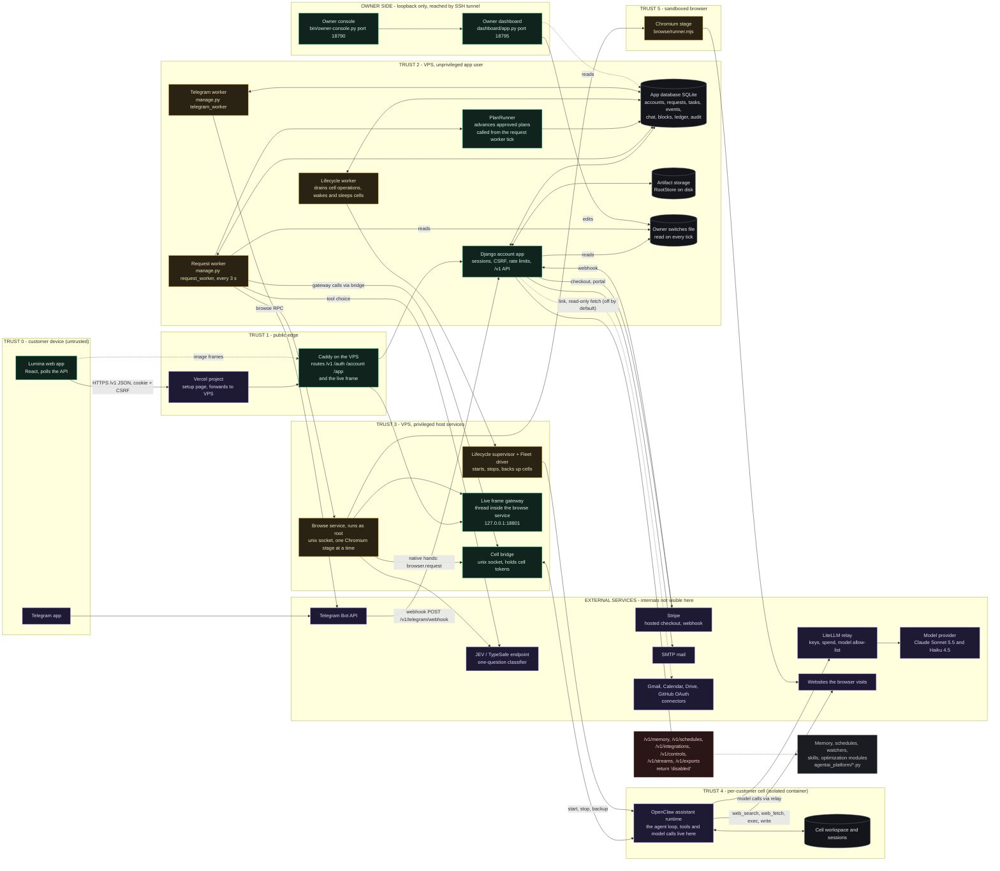

# System overview (Diagram A)

## A. System architecture

## What the diagram shows
Lumina is a thin, durable control plane around two independent agents it does not write itself: the **OpenClaw assistant** in the customer's cell (all chat reasoning, its built-in tools, and its own model calls) and Lumina's **browser job** (its own code and rules: JEV decides each step first, and hands the page to the assistant itself when it cannot). The Django app, the request worker and the lifecycle worker coordinate through one SQLite database. The worker reaches the cell only through a host bridge so that the app user never holds a cell token or a Docker socket.

### Components and entry points
| Component | Entry point | Notes |
|---|---|---|
| Web app | `lumina/src/main.tsx`, `lumina/src/App.tsx` | Served by `accounts/uishell.py:serve` at `/app/`. Calls `/v1` only. |
| Django app | `accounts/urls.py`, `accounts/views.py:endpoint`, `accounts/middleware.py:AccountMiddleware` | Auth, CSRF, rate limits, JSON API. |
| Request worker | `accounts/management/commands/request_worker.py:build_worker`, `agentai_platform/request_worker.py:RequestWorker.tick` | The only caller of the chat driver. Only ticks while switch `customer_execution` is on (`accounts/chat.py:execution_on`). |
| Chat driver | `agentai_platform/chat.py:ChatDriver.execute` | Lumina's loop around the assistant. |
| Lifecycle worker | `agentai_platform/lifecycle/worker.py:LifecycleWorker.tick` | Wakes cells that have waiting requests, sleeps idle ones. |
| Supervisor and Fleet driver | `agentai_platform/lifecycle/supervisor.py`, `fleet_driver.py` | Privileged side. Per the file docstring, refuses until custody is recorded; see findings. |
| Cell bridge | `agentai_platform/lifecycle/cell_bridge.py`, `bridge_client.py` | Unix-socket RPC. |
| Gateway | `agentai_platform/gateway.py:NativeGateway` | `open_session`, `send`, `history`, `abort`, `capabilities`, `usage_snapshot`. |
| Browse service | `agentai_platform/browse/service.py`, `service_main.py`, client `browse/client.py:BrowseRpc` | Root service; the app can only start, poll, cancel, control jobs of its own account. |
| Live frames | `agentai_platform/live/gateway.py`, `live/ticket.py`; Caddy route in `platform/deploy/caddy/Caddyfile.getlumina` | `/v1/live/<id>/frame`. Runs as a thread inside the browse service (`platform/deploy/LIVE_VIEW.md`), not as its own unit. |
| Owner dashboard | `dashboard/app.py` | Loopback port 18795; edits the switches file and reads state. |

### Storage entities (SQLite, `platform/migrations/0001` to `0027`)
Customer and request path: `accounts`, `memberships`, `projects`, `conversations`, `chat_messages`, `chat_deliveries` (0005:27), `customer_requests` (0004:5), `request_slot`, `tasks` (0001:6), `task_reservations` and ledger entries (0003), `events` (0008), `ui_blocks`, `plan_phase_runs` (0018), `browse_runs` and browse steps (0019), `pursuit` rows (0026), saved choices (0023), vault (0024), `route_decisions` (0015), artifacts and files (0007), billing (0013), `audit`. Lifecycle: `deployments`, `operations`, `lifecycle_cells`, `lifecycle_slot` (0001, 0002). Schedules, memory and connector tables exist (0009, 0010, 0011) but see the unrouted note below.

Files on disk: artifact bytes in `settings.STORAGE_DIR` via `agentai_platform/storage.py:RootStore`; each cell's workspace and sessions in its own volume (`lifecycle/volumes.py`). The assistant's transcript is authoritative inside the cell; `chat_messages` is Lumina's mirror (`chat.py:ChatDriver._absorb`).

### Real-time channels
- **Polling is what the app uses.** `lumina/src/pages/Chat.tsx:56` polls messages and tasks every 2.5 s while a task is working; `lumina/src/components/AgentThinking.tsx` polls `/v1/tasks/<id>/events` every 2.5 s.
- **Server-sent events exist but the app does not use them.** `accounts/streams.py:stream` implements `/v1/tasks/<id>/stream` (cap of three streams per account, `agentai_platform/events.py:MAX_STREAMS_PER_ACCOUNT`). No `EventSource` appears in `lumina/src`.
- **Live view** uses image frames (`/v1/browse/<id>/live`, `/v1/live/<id>/frame`) and a terminal view built from events.

### Trust boundaries in practice
1. **Customer to edge:** cookie session (`Secure; HttpOnly; SameSite=Strict`), CSRF token from `/v1/csrf`, rate limits (`accounts/middleware.py`, `accounts/services.py:rate`).
2. **App user to privileged services:** unix sockets only (`CELL_BRIDGE_SOCKET`, `BROWSE_SOCKET`). The app cannot start a browse job for another account (service docstring, `browse/service.py:1-5`).
3. **Cell to everything else:** the assistant is treated as untrusted. Its structured `lumina-step` requests are re-validated and neutralised (`agent_protocol.py:clean`, `browse/untrusted.py:neutralize`) before they can become browser goals.
4. **Web content to the agents:** page text is neutralised for prompt-injection phrases before the browser agent or the assistant sees it. Code rules, not models, decide payments, sign-in pages and denied domains (`browse/loop.py:Policy.gate`).

## Implemented but not reachable
These exist as modules and tables but are not imported by any non-test code, and their `/v1` routes resolve to the generic `disabled` view (`accounts/urls.py:24-27`):
- `agentai_platform/memory.py` (Lumina-side memory), `schedules.py` (`ScheduleService`), `watchers.py`, `optimization.py`, `skills.py`.
- Routes `/v1/memory`, `/v1/schedules`, `/v1/integrations`, `/v1/controls`, `/v1/streams`, `/v1/exports`, `/v1/tasks` (list/create).

Note: `/v1/tasks/<id>`, `/v1/tasks/<id>/events` and `/v1/tasks/<id>/stream` **are** routed (`accounts/urls.py`, lines with `ch.chat_task`, `st.events`, `st.stream`).

## What static inspection cannot establish
- **OpenClaw's internals:** its tool registry, its permission model, its own memory and cron features, and how it decides to stop. Only what Lumina sends and reads back is visible.
- **LiteLLM, the model provider and JEV/TypeSafe:** only request shapes and configuration names are visible (`agentai_platform/lifecycle/cell_config.py:15-16`, `browse/llm.py:7`, `routing/config.py`).
- **Whether production has the owner switches on.** The code reads `SWITCHES_FILE` at run time; the file's contents on the server were not inspected.
- **Whether the supervisor runs the real Fleet backend.** `lifecycle/supervisor_main.py:34` starts with `DisabledDriver` and only builds the verified backend (`lifecycle/native_wiring.py`) when the operator passes a wiring file. Whether production does is not visible here, so "start cell" in the diagrams is the intended path.
- **The deployed code version.** This map describes the local checkout.

## Evidence
- `accounts/urls.py:19-27` `shell.serve`, `v.disabled` loops
- `accounts/uishell.py:17` `serve`
- `accounts/middleware.py:44-66` `AccountMiddleware.__call__`
- `accounts/management/commands/request_worker.py:21-45` `build_worker`
- `agentai_platform/request_worker.py` `RequestWorker.tick`, `_tick`
- `agentai_platform/lifecycle/worker.py:98` `enqueue_wakes`, `:127` `tick`
- `agentai_platform/gateway.py:245` `NativeGateway`
- `agentai_platform/events.py:27` `EVENT_KINDS`, `MAX_STREAMS_PER_ACCOUNT`
- `accounts/streams.py:44` `events`, `:69` `stream`
- `lumina/src/pages/Chat.tsx:56`, `lumina/src/components/AgentThinking.tsx` (2500 ms timer)
- `platform/deploy/caddy/Caddyfile.getlumina` (handles `@liveframe` and `@customer`)
