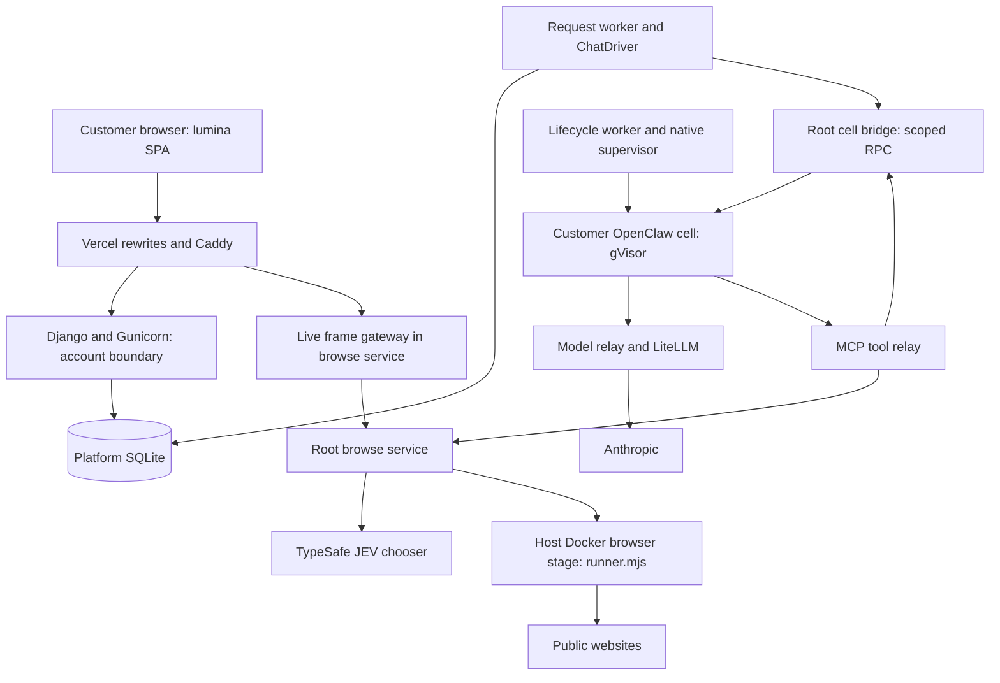
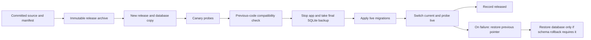

# Current system: components and trust boundaries

Rebuilt 29 October 2026 from the checked-in source at `8c10824` and the
verified deployment record. This is a code/documentation inspection, not a new
runtime acceptance test or server inspection. Last verified platform release:
`20261030T022448Z-webhook-0c48ade`, source `0c48ade`; supervisor remained on
`20261028T212308Z-tool-origin-v2`. See the [deployment evidence](../../../docs/codebase-audit/DEPLOYMENT_2026-10-29.md).

## What runs

Lumina is a hosted customer assistant. The shipping React application is
`lumina/`; `lumina-character/` is a retained fork with unique components, not
the deployed client. Django authenticates the customer and scopes operations
by session-derived account identity. Its services use SQLite. OpenClaw owns
the assistant's model/tool loop inside a customer cell; Lumina owns admission,
queueing, lifecycle, supervision, tool authorization and settlement.

Rendered: [system-overview-1.svg](svg/system-overview-1.svg).
The drawing shows service relationships, not unrestricted network reachability.
The native browser alternative is shown in [execution](native-execution.md).

## Boundaries and deployment facts

| Boundary | Implementation and current qualification |
|---|---|
| Customer edge | Vercel rewrites `/`, `/account`, `/auth`, `/v1`, `/app` to the backend. Caddy routes application requests to loopback port 18800; live frames go directly to browse port 18801. Health/readiness remain private probes. |
| HTTP identity | Cookie/session, verified identity, epoch and membership checks; account identity is not accepted from client routing overrides. Webhook signature/secret verification is a separate provider boundary. |
| Web service | `deploy/gunicorn.conf.py`: one synchronous worker. Do not treat an available SSE endpoint as a separate asynchronous service. The SPA uses polling. |
| Application storage | SQLite: account/project/conversation/request, deliveries, budget, events, artifacts and feature state. PostgreSQL belongs to the owner LiteLLM stack; it is not the customer application database. |
| Privileged operations | App/worker calls the host-owned cell bridge over its Unix socket. Root bridge/supervisor/browse services have distinct jobs; they are not web endpoints. |
| Customer runtime | Separate cells Docker engine and gVisor runtime. The host exposes model and tool relays to cells on ports 4000 and 4100. Running-cell isolation was not inspected during the last audit because none was running. |
| Model path | Cell default in `cell_config.py`: `litellm/claude-sonnet-5-5`. Other allowed models do not constitute a per-message service router. Optional routing/display observers are distinct from live browser JEV choices. |
| Browser | Recorded production default is the host `runner` engine. The native engine exists behind account/default selection in `browse-engine.json`; it is not an approved replacement merely because it is implemented. |
| Privacy | Text scrubbing cannot redact screenshot pixels. The browser code builds TypeSafe image payloads; screenshot policy changes were explicitly deferred by the owner. No packet capture was performed here. |

## Owner plane and supporting services

The owner OpenClaw Gateway, LiteLLM and PostgreSQL Compose stack is separate
from customer cells. The loopback dashboard and SSH helpers form the operator
surface. Billing worker, mail worker, ops backup and monitor are background
services. Their presence does not imply that customer Telegram/OAuth or paid
billing flows are fully enabled; see [current findings](findings.md).

The backend release process packages immutable source with a commit/hash
manifest, builds pinned dependencies, migrates a database **copy**, probes a
canary and checks the previous release against that schema. Only then does it
stop the app, take a final SQLite backup, apply live migrations and switch the
platform pointer.

Rendered: [system-overview-2.svg](svg/system-overview-2.svg).
The latest deployment verified source hashes, six service/timer states, public
request boundaries and the recovery backup. It did not replace the frontend,
change the supervisor protocol, activate features, or change the schema.

## Source map

All source links below are relative to this report; symbols are more durable
than copied line numbers.

| Claim | Source |
|---|---|
| Customer routes and disabled stubs | [accounts/urls.py](../../platform/accounts/urls.py) |
| HTTP identity/body boundaries | [middleware.py](../../platform/accounts/middleware.py), [settings.py](../../platform/accounts/settings.py) |
| Edge routing | [Vercel routing.mjs](../../platform/deploy/vercel/routing.mjs), [Caddyfile](../../platform/deploy/caddy/Caddyfile.getlumina) |
| Web worker model | [gunicorn.conf.py](../../platform/deploy/gunicorn.conf.py) |
| Worker composition | [build_worker](../../platform/accounts/management/commands/request_worker.py) |
| Cell config and model/tools | [cell_config.py](../../platform/agentai_platform/lifecycle/cell_config.py) |
| Cell RPC authorization | [cell_bridge.py](../../platform/agentai_platform/lifecycle/cell_bridge.py) |
| Browse factory, engine and JEV selection | [service_main.py](../../platform/agentai_platform/browse/service_main.py) |
| Provider relay | [agentai_model_proxy.py](../../platform/deploy/model-proxy/agentai_model_proxy.py) |
| Rollout and rollback | [release.py](../../platform/deploy/release.py) |

Next: [execution](native-execution.md), [state and recovery](state-and-recovery.md),
[current findings](findings.md).
