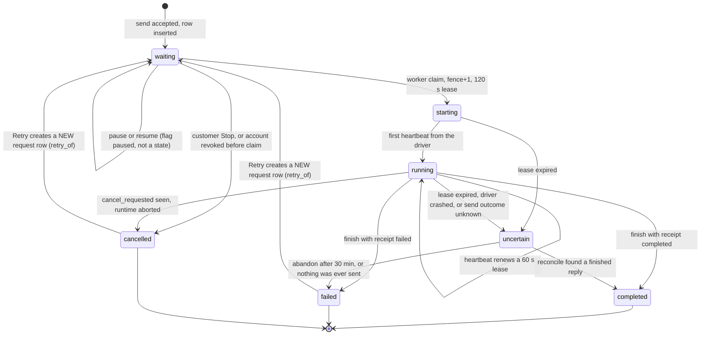
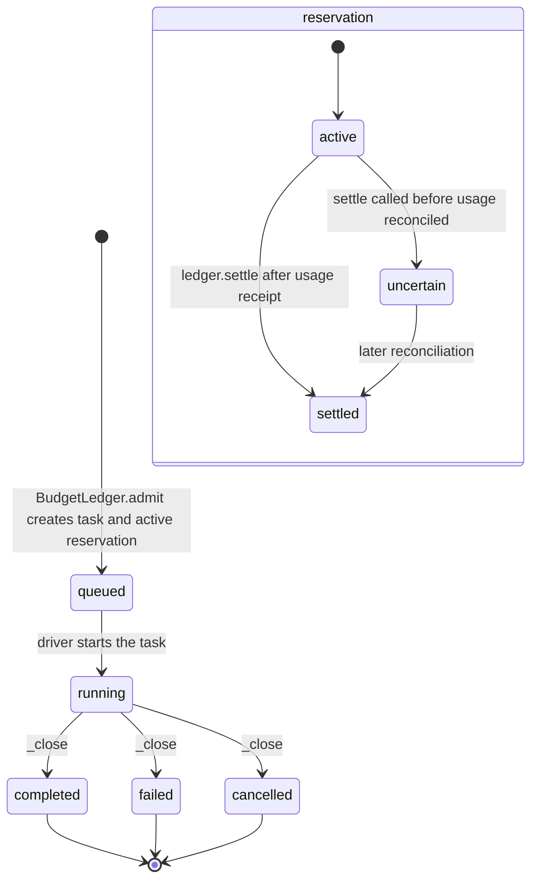
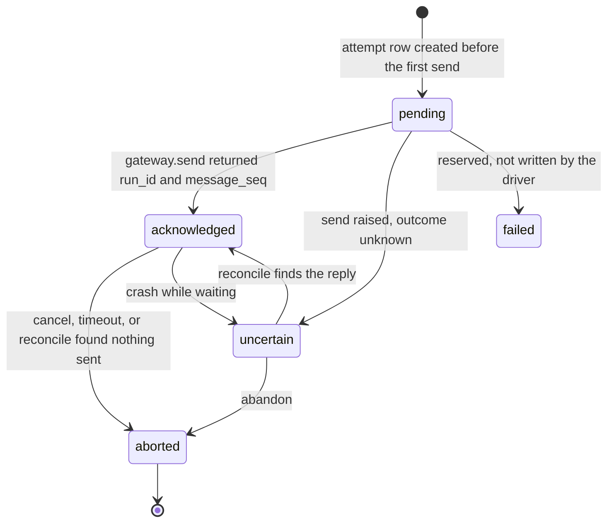
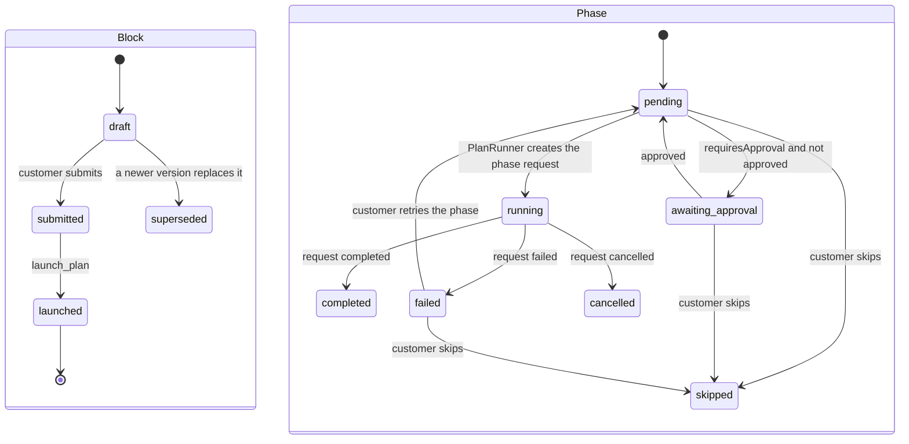

# Task lifecycle, states and recovery (Diagram E)

> **Historical.** This page describes the code before the move to native OpenClaw execution (26 Oct 2026): the `lumina-step` protocol, JEV tool choice, Pursuit, the
> round loop and transcript polling no longer exist. The current description is [native-execution.md](native-execution.md). Kept for the record.

Lumina has several state machines that run side by side. The customer-visible one is `customer_requests.state`; the others record money, delivery to the assistant, plans, browser runs and the workspace. All of them are persisted in the SQLite database. Legend: [README.md](README.md#legend-used-in-every-diagram).

## E1. Request state (`customer_requests.state`)

**Allowed values.** `waiting, starting, running, uncertain, completed, failed, cancelled` (`platform/migrations/0004_serial_requests.sql:5`). `paused` is a 0/1 column, not a state (`0022_task_control.sql:2`). `cancel_requested` is a flag; `fence` and `lease_until` guard the worker.

| Transition | Cause | Code |
|---|---|---|
| to `waiting` | `send`, a form submit, a plan phase, or a Retry | `request_queue.py:submit` (42); `chat.py:_spawn` (271) |
| `waiting` to `cancelled` | customer Stop on a request that has not started; account revoked | `request_queue.py:cancel` (86-91); `claim` (141) |
| `waiting` to `starting` | the single global slot is free, the request is the oldest unpaused one, its account's cell is active (browse requests need no cell) | `request_queue.py:claim` (126-148) |
| `starting` to `running` | the driver's first heartbeat | `request_queue.py:heartbeat` (162-170) |
| to `uncertain` | lease expired while the slot was held; an exception in the worker; `finish` after the lease expired | `request_queue.py:claim` (132), `uncertain` (157), `finish` (178) |
| to `completed` / `failed` / `cancelled` | the driver's `_close` returns a receipt; `finish` requires the runtime drained and the usage reconciled | `chat.py:_close` (559); `request_queue.py:finish` (172-185) |
| `uncertain` to terminal | `reconcile` reads the cell's transcript; or `abandon` after `abandon_after = 1800` s | `chat.py:reconcile` (1361), `abandon` (1347); `request_worker.py:_tick` |

**Persisted.** Every row above. The request's `result` column holds the public result text (trimmed to 16 000 chars). Terminal states are final: Retry never edits the old row.

**Not a state.** "Partially complete" does not exist as a request state. A run that ends early is `failed` or `cancelled` with an explanatory result; the pursuit record (below) can say `stopped`, `blocked` or `unverified_done`.

## E2. Task and money state (`tasks.state`, `task_reservations.state`)

**Allowed values.** `tasks.state`: `queued, running, waiting_for_approval, paused, cancelled, failed, budget_exhausted, completed, blocked` (`migrations/0001_foundation.sql:6`). The application writes only `queued` (`budget.py:84`), `running` (`chat.py:612,620`) and the three terminal states (`chat.py:569`). The other four values (`waiting_for_approval`, `paused`, `budget_exhausted`, `blocked`) have **no writer** in application code; they are read by the lifecycle worker (`lifecycle/worker.py:54`, `coordinator.py:223`) and the restore and diagnostics tools (`ops/restore.py:39`, `ops/diagnostics.py:34`). Treat them as reserved.

`task_reservations.state`: `active, uncertain, settled, cancelled` (`0003_budget_admission.sql:4`). Found writers set only `uncertain` and `settled` (`budget.py:111,122,126`; `ops/restore.py:156`). `cancelled` is never written.

**Consequence.** A request cancelled while still `waiting` is never claimed and so never reaches `ChatDriver._close`, the only place that settles a reservation. No other release path was found. See [findings.md](findings.md), item F-06.

## E3. Delivery to the assistant (`chat_deliveries.state`)

Allowed values `pending, acknowledged, uncertain, aborted, failed` (`0005_chat_transcript.sql:27`). The driver writes the first four (`chat.py:_start_delivery` 464, `_set_delivery` 475, the `uncertain` write at 671). `failed` was not found being written. **Rule enforced:** a delivery in `uncertain` is never resent; it is reconciled from the transcript (`chat.py:reconcile`), which prevents duplicate execution.

## E4. Plan blocks and phases (`ui_blocks.status`, `plan_phase_runs.state`)

Values: block status `draft, submitted, launched, superseded` (`0017_generative_ui.sql:15`); phase state `pending, running, awaiting_approval, completed, failed, skipped, cancelled` (`0018_plan_runs.sql:8`). Code: `genui/runner.py:54-56` (request outcome to phase state), `91-95` (approval gate), `159-175` (retry and skip), `188` (cancel). Each phase request is itself a normal `customer_requests` row (E1).

## E5. Pursuit record, browser run and cell

These are not shown as separate diagrams because they are lists of values rather than driven machines.
- **Pursuit** (`pursuit.py:14`, only while owner switch `pursuit` is on): `planning, running, waiting_user, replanning, verifying, verified, unverified_done, blocked, stopped, cancelled, interrupted`. Verify levels: `executed, subgoal_done, appears_complete, verified, unverifiable` (`pursuit.py:17`). Written by `ChatDriver._save_pursuit` (950); an interrupted or cancelled request is marked in `_close` (570-577).
- **Browser run** (`browse_runs.status`, free text column, `0019_browse_runs.sql:6`): written `queued` by the worker, then mirrored from the service. Service states are `queued, running, paused, asking` plus the finals `done, handoff, stopped, blocked, budget, error, cancelled, stuck, max_steps, deadline, replan` (`chat.py:_run_browse`, `browse/loop.py:65`).
- **Workspace cell** (`lifecycle_cells.observed_state`): `absent, stopped, running, unknown` (`0002_lifecycle.sql:4`). Operations (`operations.kind`): `create, start, stop, upgrade, backup, restore` and more (`0001_foundation.sql:7`). The lifecycle worker's idle rule: drain and stop after `IDLE_AFTER_SECONDS = 900` with no running, queued or approval-waiting work (`lifecycle/sleep.py:11,25`).
- **Telegram outbox** (`telegram_outbox.state`): `pending, sent, uncertain, failed` (`0006_telegram_ingress.sql:63`).

## Control actions

| Action | API | Effect | Code |
|---|---|---|---|
| Stop | `POST /v1/tasks/<id>/cancel` | Waiting: becomes `cancelled` at once. Starting, running, uncertain: sets `cancel_requested`; the driver sees it within one poll, aborts the run (or cancels the browser job) and closes as `cancelled` | `accounts/chat.py:chat_cancel`; `request_queue.py:86`; `chat.py:_poll`, `_run_browse` |
| Pause / Resume | `POST /v1/requests/<id>/pause`, `/resume` | Only for a `waiting` request. Keeps its queue place and reservation; is never claimed and never wakes the assistant | `request_queue.py:95-109` |
| Retry | `POST /v1/requests/<id>/retry` | Only for `failed` or `cancelled`. Creates a new request with `retry_of`, a new reservation and the 30 per hour task limit; with `pursuit` on, resumes from the stored plan | `accounts/chat.py:chat_retry` (233-245); `chat.py:405`; `_resume_state` (928) |
| Follow-up while running | `send` | A new request, queued behind the running one (max 3 waiting); in the same chat session when it runs | `request_queue.py:54` |
| Take over browser | `/v1/browse/<id>/pause`, `/control`, `/release`, `/answer` | Browser job pauses; deadline stops counting while the customer has the wheel | `accounts/browse.py`; `chat.py:_run_browse` |

## Recovery behaviour

| Event | What happens | Evidence |
|---|---|---|
| Customer refreshes or disconnects | Nothing is lost; the client is stateless and the next poll reloads messages, tasks, blocks and events from the database. Unsent drafts are in local storage | `Chat.tsx`; `lib/drafts.ts` |
| Request worker crashes mid-run | Lease passes; the next claim attempt marks the request `uncertain`; the next tick reconciles from the cell transcript, finishing as `completed` if a reply exists, or as `failed` with nothing charged if nothing was ever sent; if the runtime is unreachable it is abandoned after 30 min and the reserved upper bound is charged | `request_queue.py:132`; `request_worker.py:_tick`; `chat.py:1347-1402` |
| Browse service restarts | Poll returns "unknown job"; the request ends at once as an error rather than waiting for the 900 s timeout | `chat.py:_run_browse` (`BrowseJobUnknown`) |
| Browse service unreachable | Ends after 60 s | `chat.py:44,_run_browse` |
| Cell sleeps or stops | A waiting request makes the lifecycle worker start it; a request cannot be claimed until the cell is active | `lifecycle/worker.py:98`; `request_queue.py:143-145` |
| Duplicate submit | Same idempotency key and same payload returns the same request; a different payload under the same key is a conflict | `request_queue.py:51-53` |
| Account revoked while waiting or running | Waiting requests are cancelled when reached; a running request is told to cancel at its next heartbeat | `request_queue.py:138-141,162-168` |

**Limits of this analysis.** The recovery paths were read, not exercised. `platform/tests/` and `platform/accounts/test_*.py` contain tests for several of them (for example `test_service_handoff.py` is mentioned in `CLAUDE.local.md` but is no longer in the tree); they were not run for this report.
