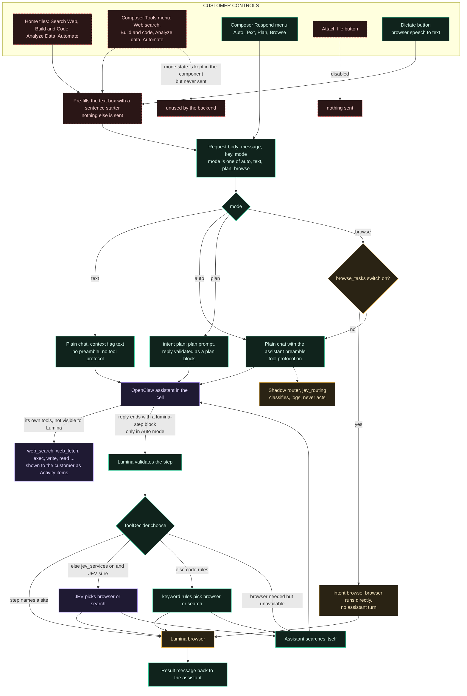
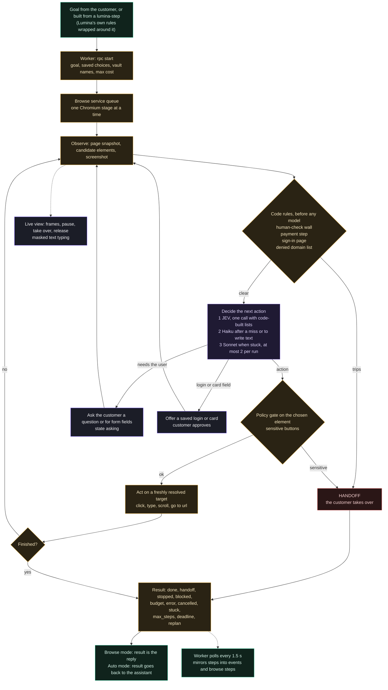
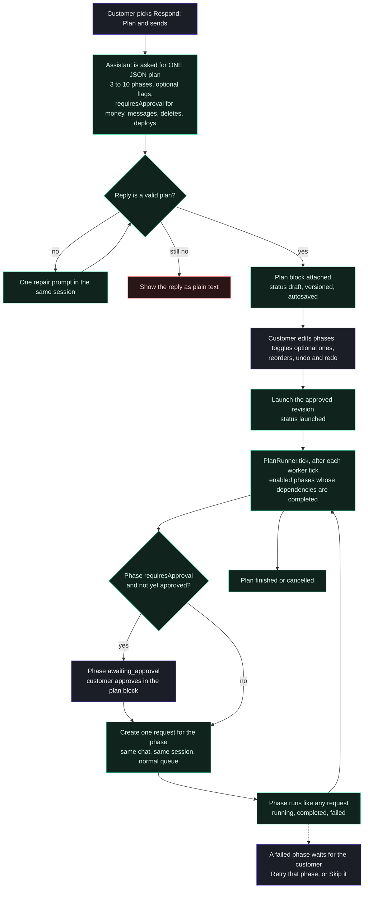
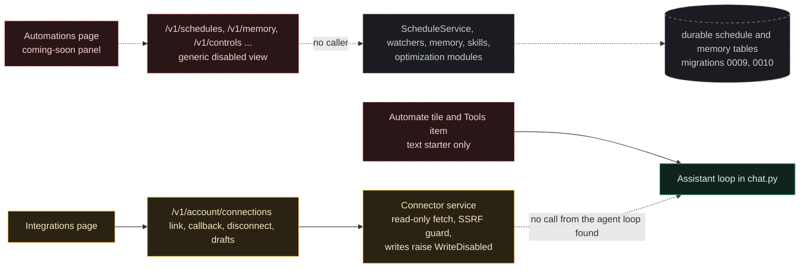
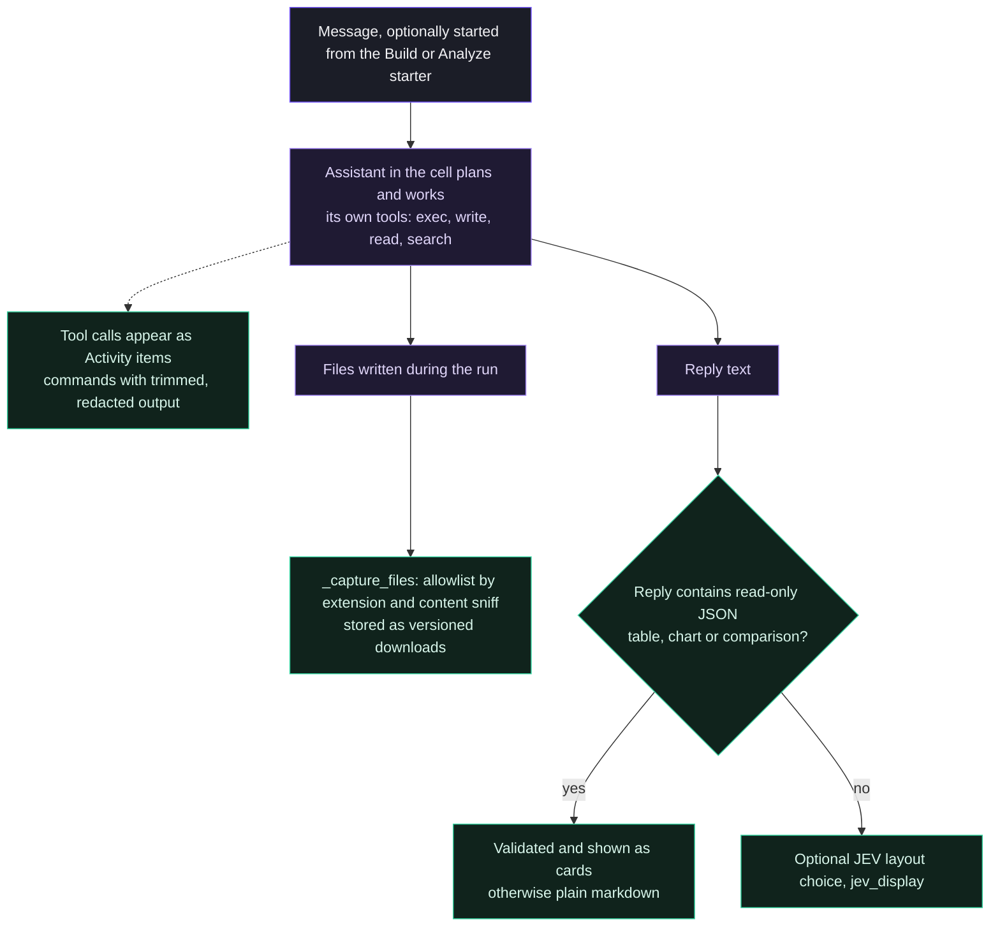

# Tool routing and capabilities (Diagrams D and F)

> **Historical.** This page describes the code before the move to native OpenClaw execution (26 Oct 2026): the `lumina-step` protocol, JEV tool choice, Pursuit, the
> round loop and transcript polling no longer exist. The current description is [native-execution.md](native-execution.md). Kept for the record.

Legend: see [README.md](README.md#legend-used-in-every-diagram). Exact identifiers are in the text under each diagram.

## D. How UI selections and the assistant's requests reach actual tools

**Plain-language reading.** Only the **Respond** menu changes what the server does. The four capability tiles on Home and the **Tools** menu in the composer only type a sentence starter into the box; the tool the customer "selected" is not part of the request. After that, the assistant decides everything. If it needs a real website it writes a structured step, and Lumina's code (and sometimes JEV) picks the browser or the assistant's own search.

**Modules.** `lumina/src/components/Composer.tsx` (`TEMPLATES` line 8, `choose` line 57, request body at line 67), `lumina/src/pages/Home.tsx:38`, `agentai_platform/chat.py:ChatService.send` (line 224, the `kind` expression), `genui/runtime.py:outgoing` (50), `agent_protocol.py` (`split`, `clean`, `PLAN_TOOLS` at 23), `routing/tools.py:ToolDecider.choose` (68), `routing/shadow.py:ShadowRouter`.

**Decision rules inside `ToolDecider.choose`**
1. If the step names a site: browser, no model call (confidence 1.0).
2. Otherwise a keyword rule gives a fallback (`rules`, line 44). If the owner switch `jev_services` is on and the routing config and key file exist, one JEV question is asked (8 s deadline); an answer below 0.6 confidence is ignored.
3. If the browser is chosen but `browse_enabled` is false: search instead, with a note.
4. Any exception returns search.

**What the code does when Browse mode is chosen and the switch is off.** `chat.py:send` computes `kind = 'browse' if mode == 'browse' and self.browse else 'text'`, so the request silently becomes ordinary chat. The UI hides the Browse option unless `/v1/app` reports `features.browse` (`Composer.tsx` filter on `RESPONSES`), so this is a safeguard rather than a visible state.

## The four capability buttons and the Tools menu

| Control | Where | What it actually does | Evidence |
|---|---|---|---|
| **Search Web** tile | Home | Types `Search the web and summarize: ` into the composer and focuses it. No structured field, no tool restriction | `Composer.tsx:8` `TEMPLATES.Web`; `Home.tsx:38` |
| **Build & Code** tile | Home | Types `Build or fix this in code: `. Same path as any message. For "a website, an app, a whole system" the preamble tells the assistant to suggest Plan mode instead of starting | `Composer.tsx:8`; `agent_protocol.py:169` |
| **Analyze Data** tile | Home | Types `Analyze this data and explain the key findings: `. No data ingestion exists behind it (uploads off) | `Composer.tsx:8` |
| **Automate** tile | Home | Types `Set up a recurring task that: `. **No scheduler is created.** The assistant can answer in text; Lumina's schedule engine is not routed | `Composer.tsx:8`; `accounts/urls.py:24` |
| **Tools** menu (new chats only) | Composer | Same four sentence starters. Selecting one toggles a label on the button; the selection is **not sent**. Not shown on an existing chat | `Composer.tsx:57,89`; request body `Composer.tsx:67` |
| **Respond** menu | Composer | Sets `mode`: Auto, Text, Plan, Browse. This is the only selection that reaches the backend. Browse is hidden unless `features.browse` | `Composer.tsx:39,67,89`; `chat.py:224` |
| **Attach** | Composer | Disabled (always, in this build). A pasted file is refused with a message | `Composer.tsx:82,84` |
| **Dictate** | Composer | Browser speech recognition appends text; no server involvement | `Composer.tsx` `toggleVoice` |

**Overlap.** The Tools menu and the Home tiles are the same four templates reached from two places and share the `TEMPLATES` table. The Respond menu is separate and is the only control that picks an execution path. Tools and Respond never interact in code.

## Capability matrix

Status key: **Live** = implemented and connected on the request path (may need an owner switch); **Partial** = connected but narrower than the UI suggests; **UI only**; **Unrouted** = code exists, no route or caller; **Docs only**; **External** = behaviour not visible here.

| Capability | Frontend entry point | Backend handler | Execution mechanism | Tools or services | Persisted outputs | Status | Evidence |
|---|---|---|---|---|---|---|---|
| Normal chat | Composer, Auto or Text | `chat_send` → `ChatService.send` → queue → `ChatDriver.execute` | The assistant in the customer's cell, via gateway | OpenClaw, LiteLLM, Claude Sonnet 5.5 | `chat_messages`, `events`, ledger | Live (needs `customer_execution`) | `accounts/chat.py:162`; `chat.py:224,584` |
| Plan mode | Respond: Plan | `ChatService.send` intent `plan`; `GenUiRuntime.validate_reply`, `attach_plan`; `launch_plan`; `PlanRunner` | Draft plan by the assistant, edited by the customer, each approved phase run as its own request | Same as chat | `ui_blocks` (versions), `plan_phase_runs`, requests per phase | Live | `chat.py:224,297,322`; `genui/runner.py:61,72`; `genui/runtime.py:76,86` |
| Web search and research | Tiles, Tools, or any message | The assistant's own search tools; Lumina nudges via `_answer_step` when JEV says search | Inside the cell | `web_search`, `web_fetch` (names from `activity.py:CATEGORY`); search provider not visible | Activity events, reply text | Live, External | `activity.py:21-`; `chat.py:897` |
| Browser navigation and actions | Respond: Browse, or the assistant's `lumina-step` | `_run_browse` → `BrowseRpc` → browse service → `BrowseRunner` | Sandboxed Chromium, decision ladder JEV / Haiku / Sonnet, code rules | Chromium, LiteLLM, JEV, vault, saved choices | `browse_runs`, browse steps, screenshots, events | Live (needs `browse_tasks`) | `chat.py:776`; `browse/loop.py:105`; `browse/ladder.py:573` |
| Building and coding | Build and Code tile, or any message | Same as chat; Plan mode for big builds | The assistant's own `exec` and `write` tools in the cell | OpenClaw tools; no separate code-execution sandbox in Lumina | Files in the cell workspace; captured outputs as artifacts | Partial: text prefill plus the assistant's tools; no dedicated build workflow | `agent_protocol.py:169`; `activity.py:CATEGORY`; `chat.py:1242` |
| Code execution | Not a UI feature | Assistant `exec` tool | In the cell | OpenClaw | Activity items, command output (trimmed, redacted) | External | `activity.py:87-` |
| File ingestion, parsing, retrieval | Attach button | `files.upload` route exists, returns `uploads_not_enabled` unless `UPLOADS_ENABLED` and storage are set | none connected to the assistant: the chat driver never reads uploaded files | Scan capability | `files`, `artifacts` tables | UI only; backend unconnected to the agent | `Composer.tsx:84`; `accounts/files.py:73-80`; no file reads in `chat.py` |
| Data analysis | Analyze Data tile | The assistant analyses in text; reply JSON becomes cards | Assistant tools; `genui/data.py` validates card JSON | Card renderer in the app | `ui_blocks` kinds table, chart, comparison and others | Partial: presentation of results only | `genui/data.py`; `chat.py:attach_cards` call at execute end |
| Artifact generation | Files page, chat downloads | `_capture_files` → `ArtifactService.capture_or_version` | Reads files the assistant wrote during the task | RootStore | `artifacts`, versions, `artifact` event | Live (needs storage configured) | `chat.py:1242`; `accounts/files.py` |
| Calendar | Calendar page | none | none | none | none | UI only (a "coming soon" panel) | `lumina/src/pages/Info.tsx:16` |
| Email and other integrations | Integrations page | `accounts/connections.py`: link, callback, disconnect, drafts | OAuth link; read-only fetch with SSRF guard | Gmail, Calendar, Drive, GitHub (not registered per page text) | `connector_*` tables | Partial: connectable, but **not callable from the agent loop**; writes disabled | `accounts/connections.py`; `agentai_platform/connectors.py` (`WriteDisabled`); `Info.tsx:24` |
| Automations and schedules | Automations page, Automate tile | `/v1/schedules` returns `disabled`; `ScheduleService` has no importer | none | none | `durable_schedules` tables exist | UI only and Unrouted | `Info.tsx:17`; `accounts/urls.py:24`; `schedules.py` |
| Monitors / watchers | none | `watchers.py` has no importer | none | none | none | Unrouted | `agentai_platform/watchers.py` |
| Notifications | Bell menu in the top bar | Client derives "Failed: ..." rows from `/v1/requests` | none server-side | none | none | Live, client-side only | `Shell.tsx` notifications menu |
| Telegram | Settings link flow (feature flag) | `tg.webhook` → `TelegramService` → `ChatService.send(provenance='telegram')` | Same queue and driver | Telegram Bot API | `telegram_*` tables | Partial: inbound messages run; **no code path pushes task results back to Telegram** (the outbox is only used for command replies) | `agentai_platform/telegram.py:117,298`; `accounts/management/commands/telegram_worker.py` |
| Memory and personalization | None in Lumina UI except saved info (removed) | `saved.py` and `vault.py` feed names into the preamble and the browser; `memory.py` unrouted | Preamble text and browser prefs | none | `saved_choices`, vault items | Partial: saved choices and vault only; `/v1/memory` disabled | `chat.py:885`; `accounts/urls.py:24` |
| Approvals before consequential actions | Plan editor; Live view | Plan phases `requiresApproval`; browser handoff and ask | `awaiting_approval` state; browser `asking` and `handoff` | none | `plan_phase_runs.approved_epoch` | Partial: not applied to the assistant's own tools | `genui/runner.py:91-95`; `browse/loop.py:152-173,456` |
| Live view and task activity | Live page, Activity panel, orb | `accounts/browse.py` routes, `accounts/streams.py`, `/v1/tasks/<id>/events` | Polling and image frames | Caddy frame route | `events`, browse steps | Live | `lumina/src/pages/Live.tsx`; `accounts/browse.py:97-192` |
| Billing and plans | Billing page (classic UI) | `accounts/billing.py` | Stripe hosted pages | Stripe | billing tables | Live behind `billing_live` (not verified here) | `accounts/billing.py` |

## F1. Browser actions (Browse mode, or a step the assistant asked for)

**Notes.** Payment is never performed: `Policy.read_only` defaults to true and any payment step ends in a handoff (`browse/loop.py:54-59,152-166`). Passwords are never typed by the model: a sign-in page ends in a handoff unless the customer approves a saved login (`loop.py:173,380`). The decision ladder is validated by code on every answer (`browse/ladder.py:1-12`). Every paid call is admitted against the task's budget; a refusal ends paid decisions rather than evading the cap. Page text is passed through `neutralize` before models see it.

**Unknowns.** The JEV model name and endpoint come from the routing config (`routing/config.py`) and a key file; nothing here shows how JEV decides. The Chromium sandbox image is configured outside this repo's code (`deploy/Dockerfile.sandbox`).

## F2. Plan mode and approvals

**Notes.** Approval here is a per-phase flag set by the assistant's own plan and enforced by code (`genui/runner.py:91-95`: a phase with `requiresApproval` and no `approved_epoch` is set to `awaiting_approval`). The plan schema comes from `genui/schema.py` and `genui/prompts.py:plan_prompt` (line 11). Phase request states are the normal request states; phase states are `plan_phase_runs.state` (0018_plan_runs.sql:8). A failed phase is not advanced past automatically: the customer can retry it (`genui/runner.py:164`, only a failed phase) or skip it (`runner.py:168-175`, a pending, awaiting-approval or failed phase), and `tick` treats `completed` and `skipped` as done (`runner.py:82`).

## F3. Automations, schedules and integrations (what exists versus what runs)

**Reading.** Nothing the customer can click creates a recurring job, a watcher or a notification schedule. The only automation-like path is the assistant choosing to talk about it (or using its own runtime features, which are not visible here). The connector service can store a link and propose drafts, but `chat.py` and `agent_protocol.py` never import it, so the assistant cannot read mail or calendar through Lumina.

**Evidence:** `accounts/urls.py:24-27`, `lumina/src/pages/Info.tsx:16-26`, `accounts/connections.py`, grep for importers of `memory`, `schedules`, `watchers`, `optimization`, `skills` returns none outside tests, `connectors.py:46` (`WriteDisabled`).

## F4. Coding and data analysis

**Notes.** Lumina does not run code itself. Code execution and file creation are the assistant's own tools in its isolated cell. Lumina's code observes the results (activity, files) and validates the presentation of JSON as cards (`genui/data.py`, `genui/schema.py`). There is no Lumina-side build, test or deploy pipeline; a "Deploy application" phase in a plan is just a request to the assistant.

**Evidence:** `activity.py:CATEGORY`, `chat.py:1242` (`_capture_files`), `chat.py:attach_cards` call, `genui/data.py`, `files.py:ALLOWLIST`.
