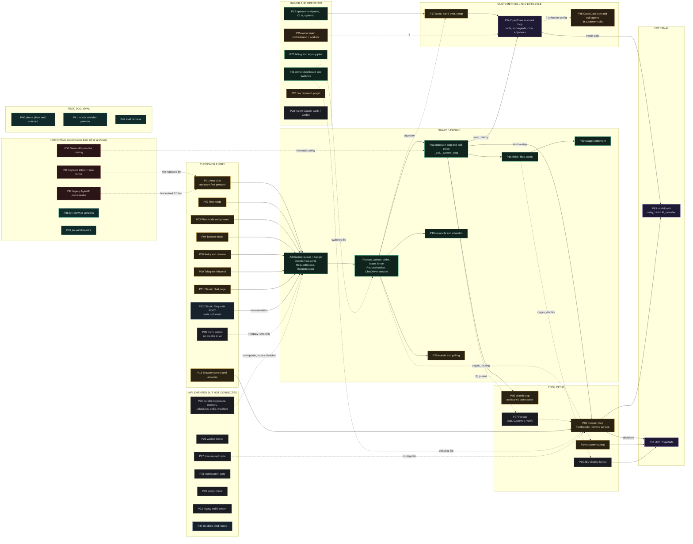
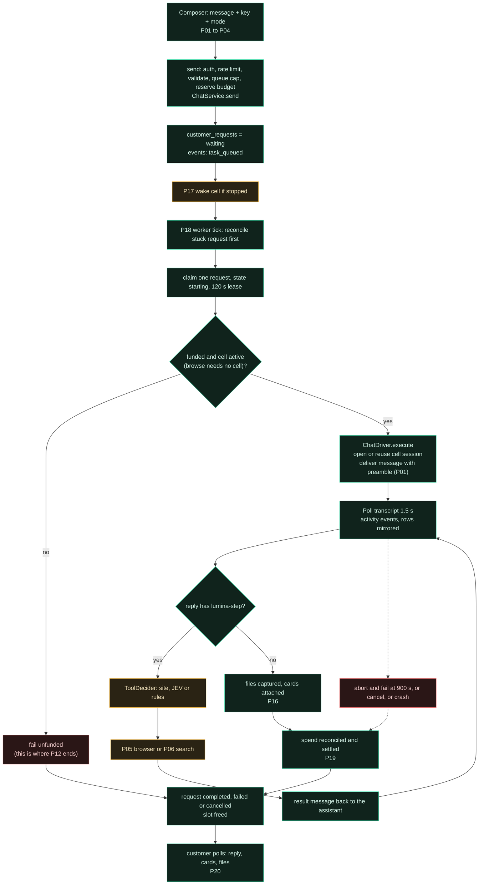
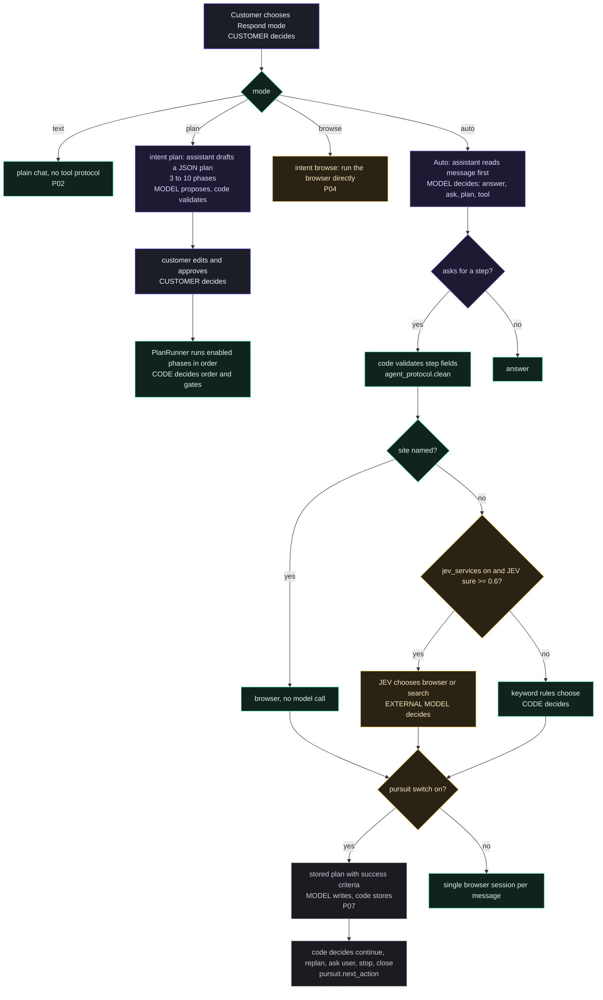
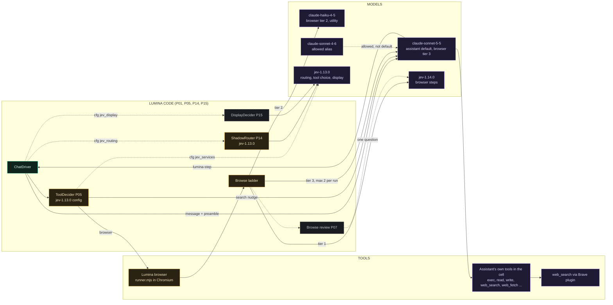
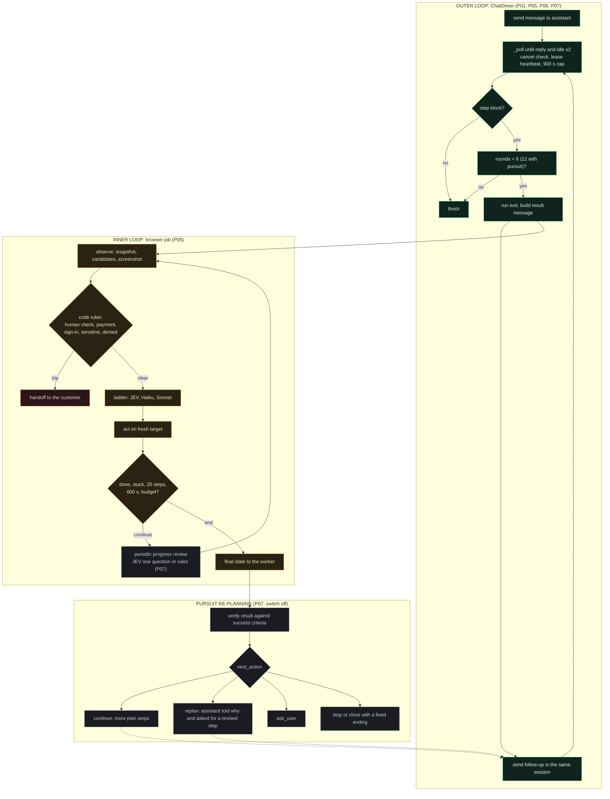
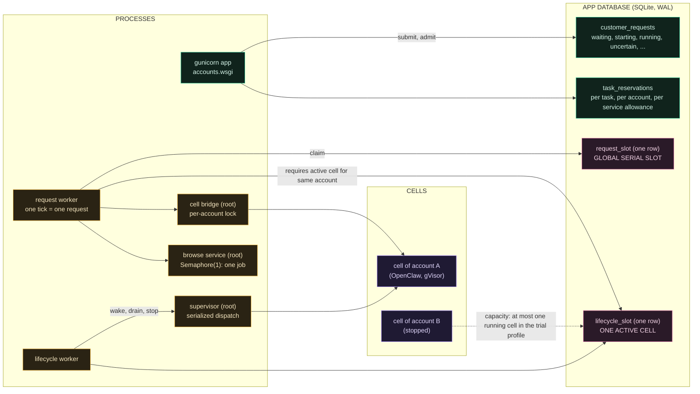
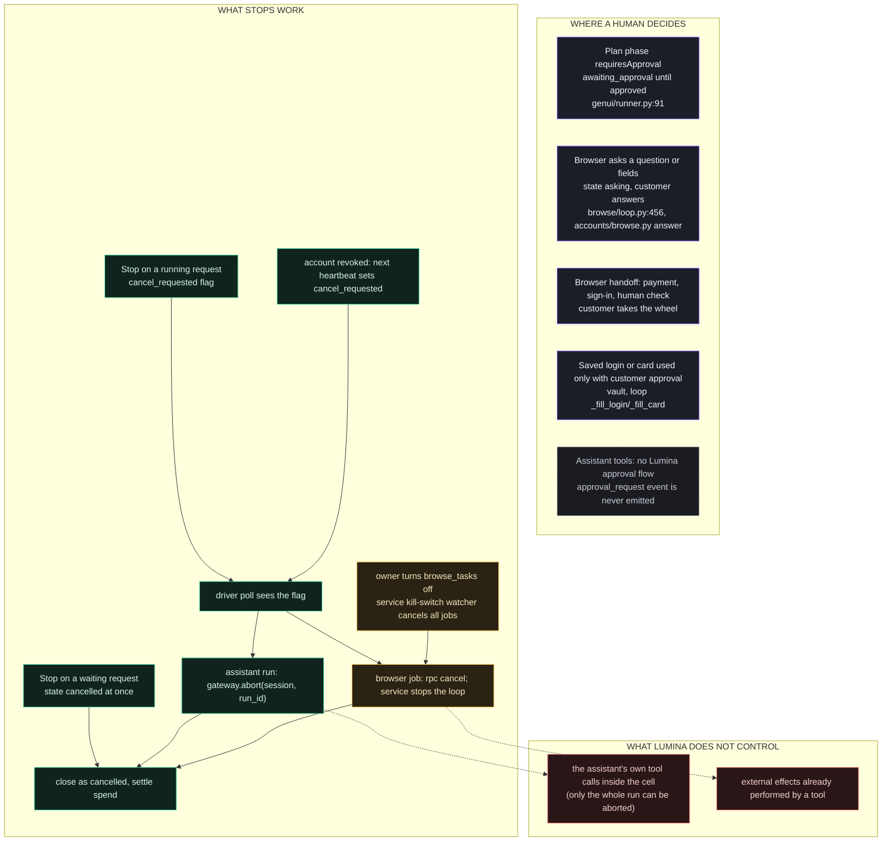

# Current orchestration (diagrams 1 to 7)

Legend for every diagram in this audit:

| Style | Meaning |
|---|---|
| Green solid box | Current and reachable |
| Amber box | Reachable under specific configuration (owner switch, setting or running service) |
| Grey dashed box | Implemented but disabled, or apparently unreachable |
| Blue-grey box | Legacy but still partially active |
| Red dashed box | Deleted from the tree but recoverable from Git; or superseded |
| Violet box | External or not inspectable |
| Teal box | Test-only, mock, experiment, prototype or documentation-only |
| Orange dotted box | Uncertain |
| **Solid arrow** | Current connection, verified in code |
| **Dashed arrow `cfg`** | Conditional connection (switch or setting) |
| **Dashed arrow `?`** | Uncertain relationship |
| **Arrow labelled `hist`** | Historical connection (not part of current execution) |

Node names carry the path identifier from [02-path-registry.md](02-path-registry.md). Exact functions are in the tables under each diagram.

## 1. Complete orchestration landscap

**Reading.** Nodes with no arrows (P23, P26, P28, P29, P31 to P33, P38 to P42) are in their group because they have no verified connection to the customer engine; their relationships are in [02-path-registry.md](02-path-registry.md). Everything customers can start flows through one admission step, one worker and one driver. The only intelligence Lumina's code has is (a) deterministic rules and (b) small JEV questions to a third party. The assistant (P24) and the browser agent (P05) make the open-ended decisions. A large amount of implemented code (P27 to P33) is not connected to any caller, and several historical engines (P35 to P37) are recoverable from Git only.

## 2. Current end-to-end request flow

| Step | Function | Evidence |
|---|---|---|
| send and reserve | `ChatService.send`, `BudgetLedger.admit` | `chat.py:224`, `budget.py:74-91` |
| claim | `RequestQueue.claim` | `request_queue.py:126` |
| funded check | `RequestWorker._tick` | `request_worker.py` (unfunded branch) |
| deliver | `ChatDriver.execute` | `chat.py:584` |
| poll | `ChatDriver._poll` | `chat.py:1300` |
| tool step | `_answer_step` | `chat.py:897` |
| finish | `_capture_files`, `attach_cards`, `_close` | `chat.py:1242,730,559` |
| settle | `_reconcile_usage`, `ledger.settle` | `chat.py:521`, `budget.py:116` |

## 3. Planning and decision flow

**Decision ownership in one line each.** Mode: customer. Whether to plan, ask, answer or use a tool: the assistant model. Whether a step is well-formed and which tool runs: Lumina code, with an optional JEV answer. Whether to continue after a browser session: the assistant (one session) or code (`pursuit.next_action`) when `pursuit` is on. Whether a browser action is allowed: code rules, never a model. See [07-registries.md](07-registries.md#decision-ownership-matrix).

## 4. Model and tool-routing flow

**Notes.** The assistant model is chosen by provisioning (`DEFAULT_MODEL`), never per request. JEV is called under two model ids: `jev-1.13.0` (routing config default, tool choice, display, optimization, research adapter) and `jev-1.14.0` (browser, pinned in `browse/service_main.py:20`). Model access for cells goes through the relay that allows only completions and model listing (`deploy/model-proxy/agentai_model_proxy.py:9`). Detailed registry: [07-registries.md](07-registries.md#tool-and-model-registry).

## 5. Execution loop and replanning

**Loop controls (from code).** Outer: `SETTLE_POLLS=2`, `MAX_STEP_ROUNDS=6`, `PURSUIT_MAX_ROUNDS=12`, `poll_interval=1.5`, `run_timeout=900`, `usage_wait=45` (`chat.py:41-44,431`). Inner: `max_steps=25`, `max_seconds=600` (service caps 40 and 900), ladder `max_sonnet=2`, one job at a time (`browse/loop.py:79`, `service.py:166,179`, `ladder.py:577`). Without pursuit, the assistant (not code) decides whether to continue after a result; there is no code-level evaluation of whether the final answer satisfies the request.

## 6. Queue, worker, cell and concurrency architecture

**Concurrency scopes, as implemented.**
- **Requests:** one running request across **all** customers (`request_slot` row, `RequestQueue.claim` returns nothing while the slot is held; `request_queue.py:128-131`). Per account only 3 may be `waiting`.
- **Cells:** the trial capacity profile allows one running cell; `wake_plan` hands over only when the other cell is idle (900 s, or 60 s when another account waits) (`lifecycle/sleep.py`, `worker.py:152`). Host capacity is read at run time (`lifecycle/capacity.py`, default 2 per file note).
- **Browser:** one job at a time on the host (`Semaphore(1)`); job state is in service memory, so a restart loses running jobs.
- **Within a cell:** OpenClaw serialises runs per session lane (docs `agent-loop.md`).
- **Bridge:** one connection and lock per account (`cell_bridge.py:157-190`).

## 7. Approvals, interruption and cancellation

**Interruption by a follow-up message.** A new message while a request runs is a new request (queued, max 3 waiting) and runs afterwards in the same cell session; it does not steer the running run. OpenClaw's own queue modes (steer, followup, collect, interrupt) are not used by Lumina's bridge, which only exposes `chat.send` / `chat.abort`.

**Resumption.** Approvals gate phases by state, not by pausing a process: a phase that awaits approval simply has no request yet (`runner.py:91-95`). The browser `asking` state is a live pause inside the job (deadline extended while waiting, `chat.py:_run_browse`). A crash during either loses only the in-memory browser job.

**Evidence:** `request_queue.py:86-109,162-170`; `chat.py:_poll`, `_run_browse`, `abort`; `browse/service.py:64 (watch_kill_switch)`; `events.py:37`; `genui/runner.py:91-95,159-188`.
