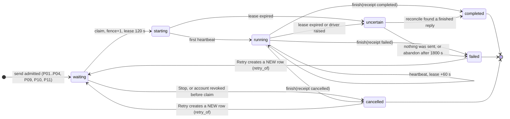
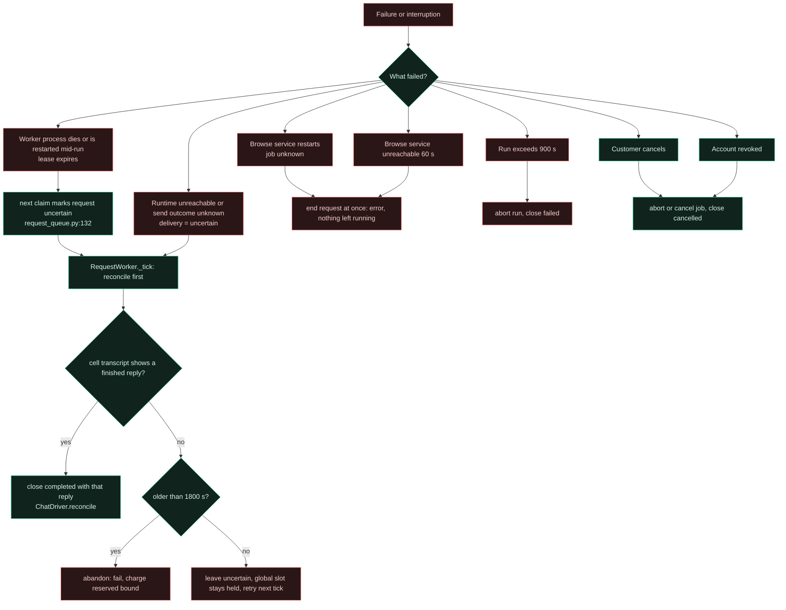
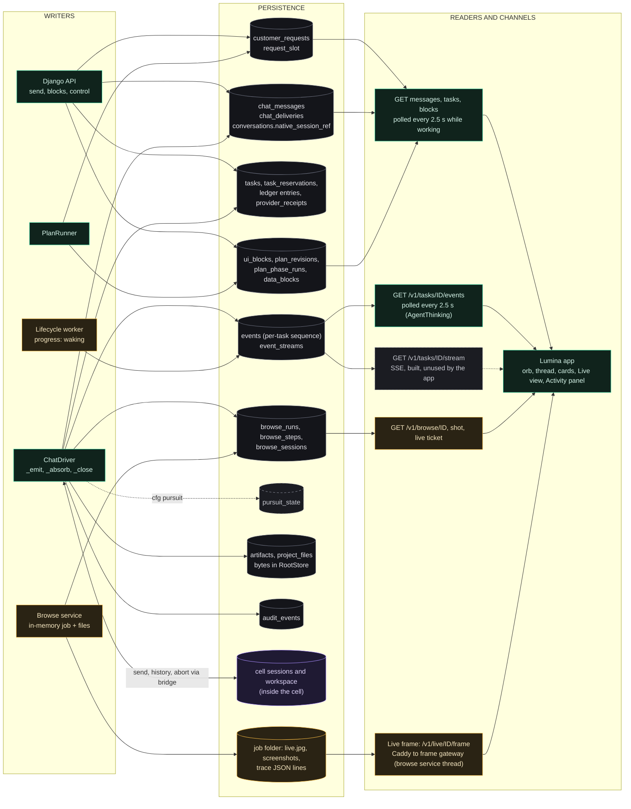

# State, events and persistence (diagrams 8 and 9)

Legend: see [04-current-orchestration.md](04-current-orchestration.md#legend-for-every-diagram-in-this-audit).

## 8. Task state and recovery

Several state machines run side by side. The first is what the customer sees. Details of each transition are in the catalog below.

**Stuck or contradictory states (confirmed in code).**
- While a request is `uncertain` and the runtime cannot be reached, it holds the one global request slot for up to 1800 s; every other customer waits (`request_queue.py:128-131`, `request_worker.py:_tick`).
- `tasks.state` stays `queued` for a request cancelled while still `waiting`; its reservation is not released by `RequestQueue.cancel` (see [08-inconsistencies.md](08-inconsistencies.md), I-06).
- `tasks.state` values `waiting_for_approval`, `paused`, `budget_exhausted`, `blocked` have no writer in application code, although the lifecycle worker and restore tooling read them.

## 9. Persistence, events, polling and frontend updates

**Mechanics (verified).**
- **Events** are appended by trusted host code only (`EventService.append`), with per-kind allow-listed payload keys, recursive secret redaction, 32 KiB and 2000-event caps, 30-day retention (`events.py`). Cursor reads are gap-free by sequence.
- **Transcript** authority: the cell's session is authoritative for execution; `chat_messages` mirrors it by native message identity (`ChatDriver._absorb`).
- **Frontend** updates are pull-based. The chat page polls every 2.5 s while any task is working (`lumina/src/pages/Chat.tsx:56`); `AgentThinking.tsx` polls events every 2.5 s and `lib/orbs.ts:agentActivityFor` maps request state and event kinds to orb state and label; Live view polls steps and fetches frames.
- **SSE** (`accounts/streams.py:stream`, three streams per account, 900 s TTL) is not used by the app.
- **Browse job data** lives in service memory plus a per-job folder; a restart keeps the files (purged after 24 h) but loses the live job (`browse/service.py:385 purge`, `BrowseJobUnknown`).

## State and event catalog

### State machines
| Entity | Column | Values | Written by | Persisted |
|---|---|---|---|---|
| Request | `customer_requests.state` (0004:5) | waiting, starting, running, uncertain, completed, failed, cancelled | `RequestQueue.submit/claim/heartbeat/uncertain/finish/cancel` | yes |
| Request flags | `paused` (0022), `cancel_requested`, `fence`, `lease_until`, `retry_of`, `intent`, `context_json` | n/a | queue, driver | yes |
| Task | `tasks.state` (0001:6) | queued, running, waiting_for_approval, paused, cancelled, failed, budget_exhausted, completed, blocked | `BudgetLedger.admit` (queued), `ChatDriver.execute` (running), `_close` (terminal). The other four: **no writer** | yes |
| Reservation | `task_reservations.state` (0003:4) | active, uncertain, settled, cancelled | `admit` (active), `receipt/settle` (uncertain, settled), restore. `cancelled`: **no writer** | yes |
| Delivery | `chat_deliveries.state` (0005:27) | pending, acknowledged, uncertain, aborted, failed | `ChatDriver._set_delivery` (all but `failed`) | yes |
| Plan block | `ui_blocks.status` (0017:15) | draft, submitted, launched, superseded | `BlockStore.set_status` | yes |
| Plan phase | `plan_phase_runs.state` (0018:8) | pending, running, awaiting_approval, completed, failed, skipped, cancelled | `PlanRunner` | yes |
| Pursuit | `pursuit_state.status` (`pursuit.py:14`) | planning, running, waiting_user, replanning, verifying, verified, unverified_done, blocked, stopped, cancelled, interrupted | `ChatDriver._save_pursuit` (switch on) | yes |
| Verification level | `pursuit.VERIFY_LEVEL` | executed, subgoal_done, appears_complete, verified, unverifiable | `pursuit.verify` | inside pursuit JSON |
| Browser job (service) | in memory | queued, running, paused, asking + finals done, handoff, stopped, blocked, budget, error, cancelled, stuck, max_steps, deadline, replan | `BrowseRunner`, `BrowseService` | `browse_runs.status` is free text, mirrored by the worker |
| Cell | `lifecycle_cells.observed_state` (0002:4) | absent, stopped, running, unknown | lifecycle driver receipts | yes |
| Deployment | `deployments.state` (0001:3) | pending, ready, stopped, failed, deleting, deleted | lifecycle coordinator | yes |
| Operation | `operations.state` / `kind` (0001:7) | pending, running, completed, failed, uncertain / create, start, stop, upgrade, backup, restore, delete | `Coordinator.run` | yes |
| Telegram outbox | `telegram_outbox.state` (0006:63) | pending, sent, uncertain, failed | `TelegramService._try_send` | yes |
| Sign-up | `signups.state` (0021:4) | unverified, pending, approved, declined | `accounts/signup.py`, `signup_admin` | yes |
| Gateway session | derived | `active_run`, history `kind` = `tail` or `reset` | `gateway.history` | not stored by Lumina |

### Event kinds (`events.py:27`)
Emitted by application code: `task_queued`, `task_started`, `plan`, `progress` (also by the lifecycle worker), `activity`, `artifact`, `result`, `error` (all in `chat.py`). **Declared but never emitted:** `search`, `file_change`, `command_result`, `test_result`, `approval_request`, `approval_decision`, `budget`. Tool use is delivered as `activity` items instead (`activity.py:CATEGORY` maps tool names to `search`, `read`, `browse`, `command`, `file` and others).

### Queues and locks
| Queue or lock | Table or object | Ownership | Concurrency |
|---|---|---|---|
| Customer request queue | `customer_requests` + `request_slot` | worker `claim` | one running request in total; 3 waiting per account |
| Lifecycle operations | `operations` | `LifecycleWorker` → supervisor | serialized dispatch, one active cell slot (`lifecycle_slot`) |
| Browse jobs | in memory, `Semaphore(1)` | browse service | one job |
| Cell session | OpenClaw session lane | OpenClaw | one run per session |
| Telegram outbox | `telegram_outbox` | `telegram_worker` | per chat order |
| Billing inbox | `billing_inbox` | `billing_worker` timer | sequential |
| Mail jobs | account mail job table | `deliver_account_mail` timer | bounded |

## Where state could become stuck or contradictory
| Situation | Why | Evidence |
|---|---|---|
| Waiting request cancelled | `RequestQueue.cancel` updates only `customer_requests` | `request_queue.py:86-93`; reservation and task close only in `ChatDriver._close` |
| Request `uncertain` with unreachable runtime | Global slot held until abandon (1800 s) | `request_worker.py` `abandon_after=1800` |
| Browse job lost on restart | Jobs are in memory | `browse/service.py:166`; `BrowseJobUnknown` handled in `_run_browse` |
| `browse_runs` rows left `queued` | Release notes record two stale rows | `RELEASE_NOTES.md` "Known limits" |
| Form block with no creator | `submit_block` exists, no non-test `create_form` | `genui/store.py:61` |
| Reserved task states never written | Schema allows more than code produces | `0001_foundation.sql:6` versus `chat.py:569,612,620`, `budget.py:84` |
