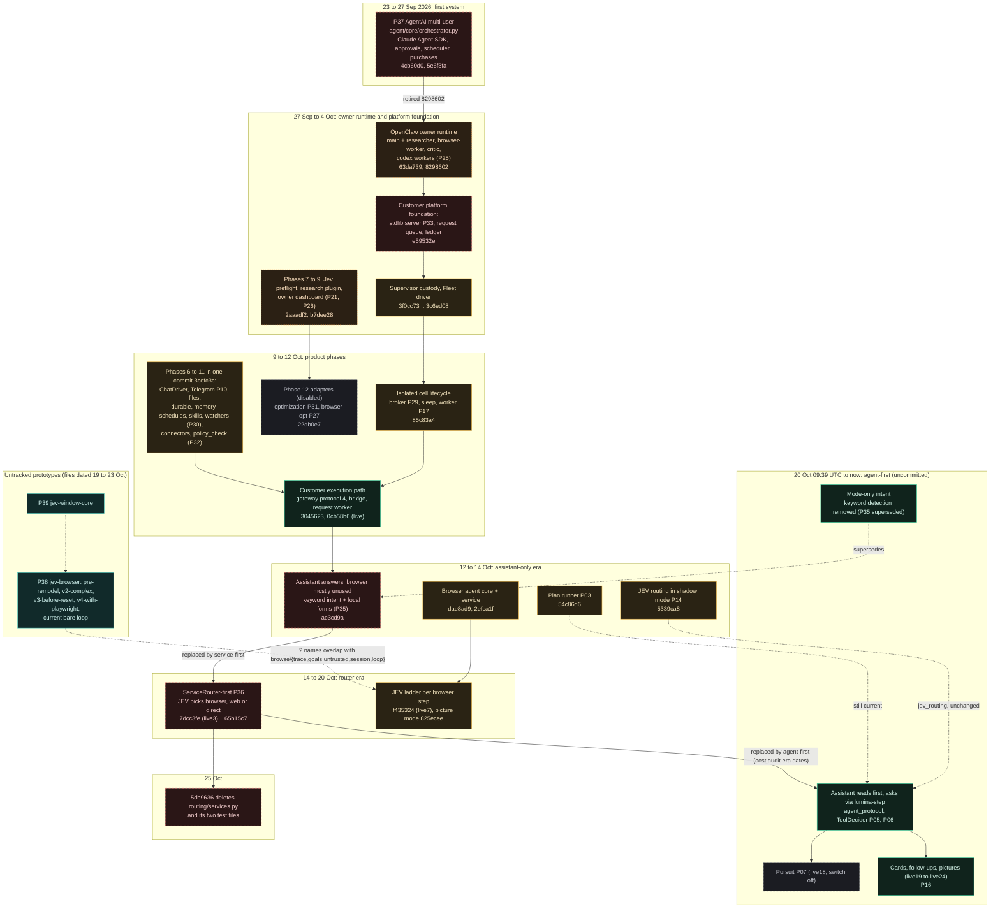

# History, replacement map and legacy remnants (diagram 10)

Sources: `git log` of all 122 commits, path histories (`git log --diff-filter=A|D`, `--follow`), historical file reads with `git show <sha>:<path>`, `RELEASE_NOTES.md`, `lumina-cost-audit/LUMINA_COST_AUDIT.md`, `plans/pursuit-architecture.md`, and file timestamps for untracked material. No working tree or branch was changed. Reasons for changes are given only where a commit message or document states them.

## 10. Historical evolution and replacement map

## Evolution table

| When | Commit or branch | Change | Replaces or relates to | Status today |
|---|---|---|---|---|
| 23 Sep | `4cb60d0` | "AgentAI multi-user system": `agent/core/orchestrator.py` (Claude Agent SDK loop, 12 global slots, per-user caps, `can_use_tool` approvals), `core/{approvals,billing,router,scheduler_service,secrets_vault,skills,purchases}.py`, `tools/*`, `gateway/{telegram_bot,web_app}.py`, `sandbox/` | First system | Deleted (P37) |
| 24 Sep | `5e6f3fa` | Purchase lifecycle and payments | Extends P37 | Deleted |
| 27 Sep | `63da739` | OpenClaw deployment, phase plans, skills including `config/skills/orchestration/SKILL.md` | Owner runtime | Config in tree (P25) |
| 27 Sep | `8298602` | "retire legacy AgentAI": 118 files removed (`agent/`, specs, phase prompts) | Retires P37 | Recoverable |
| 28 Sep | `2aaadf2` | Phases 7 to 9, Jev preflight, `research-opt/plugin`, `evals/`, `dashboard/app.py` | Owner ops | P21, P26, P42 |
| 30 Sep | `e59532e` | Customer platform and serial queue: `server.py`, `request_queue.py`, `budget.py` | Foundation | `server.py` P33 unreachable; queue current |
| 30 Sep to 4 Oct | `3f0cc73` .. `3c6ed08` | Supervisor custody, Fleet driver, cell verification (`main` ends here at `3c6ed08`) | Cell lifecycle | P17 (backend wiring unknown) |
| 9 Oct | `3cefc3c` | Product phases 6 to 11: `chat.py`, `gateway.py`, `events.py`, `connectors.py`, `telegram.py`, `durable.py`, `memory.py`, `schedules.py`, `skills.py`, `watchers.py`, `policy_check.py` | Chat driver and native capabilities | Chat current; the five native-capability modules and `policy_check.py` never modified again and have no importer |
| 9 Oct | `22db0e7` | Phase 12: `optimization.py`, `browser-opt/`, disabled | Optional Jev | P27, P31 disabled |
| 11 Oct | `85c83a4` | Cell lifecycle on the new host: `lifecycle/broker.py`, `sleep.py`, `worker.py` | Isolation | P29 unreachable; P17 current |
| 12 Oct | `3045623`, `0cb58b6` | Customer execution path: protocol-4 gateway client, cell bridge, request worker; live end-to-end chat activated on the server | Replaces offline "waits" | P01 |
| 12 Oct | `5339ca8` | JEV routing: classifier, policy, shadow mode, `route_decisions` | Observation only | P14 |
| 12 Oct | `ac3cd9a` | Generative UI with keyword `intent.detect` and local forms | P35 | Superseded |
| 12 Oct | `54c86d6` | Plan runner per phase | P03 | Current |
| 12 Oct | `dae8ad9`, `2efca1f`, `204b553` | Browser agent core, service, request path, switch `browse_tasks` | P04, P05 | Current |
| 13 Oct | `d658d64` | "JEV chat routing off" (privacy hardening: model relay, scrubber) | Disables routing of chat to TypeSafe | Shadow route remains switchable |
| 14 Oct | `7dcc3fe` (live3), `d67d15e` (live4) | `ServiceRouter` | P36 | Deleted `5db9636` |
| 15 Oct | `9dc1f9b`, `8d8fafe`, `f435324` (live7) | JEV decides each browser step; hand-off ladder to Claude; JEV mode `live` on the server | P05 ladder | Current |
| 17 Oct | `65b15c7` | "send far fewer ordinary messages to TypeSafe" | Narrows P36 | Superseded |
| 19 Oct | `825ecee`, `285590b`, `f6ce2e3` | JEV 1.14 picture mode, trace, 8 s deadline | P05 | Current |
| 20 Oct 09:39 UTC | uncommitted | Agent-first: `agent_protocol.py`, `routing/tools.py` | Replaces P36 in practice | Current (working tree and deployed releases) |
| 21 Oct | uncommitted (live18 to live24) | Pursuit, cards, follow-ups, pictures, browser Sonnet fix | P07, P16 | See release notes |
| 23 to 25 Oct | `46554f1` .. `5db9636` | Frontend film, themes; `5db9636` also deletes `routing/services.py`, `tests/test_services.py`, `tests/test_service_handoff.py` | Unrelated to the commit message | Deletion committed; replacement uncommitted |
| 19 to 23 Oct | untracked files | `jev-browser/` (and 4 archives), `jev-window-core/` | Prototype loops | P38, P39 |

## Branch and tag map
| Ref | Relation to `product-phases-6-11` | Orchestration difference |
|---|---|---|
| 14 `worktree-*` branches (all but one) | ancestors, ahead 0 | None. They are earlier checkouts of the same line (for example `worktree-emoji-jev` = `7dcc3fe`, the `ServiceRouter` introduction commit). |
| `worktree-product-images` | ahead 1 (`b956e68`, 20 Oct) | Adds `genui/images.py`, `accounts/media.py`, migration **`0023_card_images.sql`** and tests. The working tree has the same feature as untracked files with the migration renumbered to `0025_card_images.sql` (and `0023_saved_choices.sql` taken by another feature). |
| `main` | 95 behind, ends `3c6ed08` (4 Oct) | Pre-chat. |
| `origin/main` | merge of PR #1 (`515fdde`) | GitHub is suspended per `RELEASE_NOTES.md`; nothing after `d21e6b5` was pushed. |
| Tags `release/live1` to `live8` | live1 `5d8664b` .. live8 `02877e4` | Exact code for those releases. live9 to live24 have **no tag and no commit**. |
| Tag `lumina-character-final` | created 25 Oct in this work | Frontend only. |
| Two worktree checkouts with uncommitted changes | `fastclick` (1), `live-view` (1) | Not inspected beyond counts. |

## Legacy and historical implementations in detail

### P37 Legacy AgentAI orchestrator (deleted, recoverable)
Read from `git show 8298602^:agent/core/orchestrator.py` and siblings.
- **Loop:** one run per task using the Claude Agent SDK; tools exposed through an in-process MCP server so `tools.base` still enforces tenancy, logging and approvals; built-in CLI tools disabled (`tools: []`); `can_use_tool` as a second approval check.
- **Concurrency:** `Semaphore(12)` global and per-user slots by plan; contextvars for tenant isolation.
- **Events:** an in-process async bus (`core/events.py`): `task.requested`, `job.fired` handled by `handle_task_requested` and `handle_job_fired`.
- **Approvals:** `core/approvals.py` tiers; defaults in `config/limits.yaml` (safe auto; moderate auto and log for user, approval for autonomous jobs; high approval for user, deny for jobs).
- **Scheduler and purchases:** `core/scheduler_service.py`, `core/purchases.py`, `tools/payments.py`.
- **Interfaces:** Telegram bot and web app.
- **Remaining influence:** none by import. Concepts reappear: tier-style approvals in plan gating, per-task budget in the ledger. This is similarity, not a documented derivation.

### P36 ServiceRouter-first routing (deleted, recoverable)
Source at `5db9636^:openclaw-project/platform/agentai_platform/routing/services.py` (160 lines). `ServiceRouter.choose(text, previous, browser_ok)` returned a `ServicePlan` over `SERVICES = ('browser','web','direct')`, deterministic `rules` and a JEV question with measured wording ("find listings, near me, menus, prices, ordering" counted as browser). The driver ran the chosen service first and passed its output to the assistant. The committed HEAD driver still holds the call site (`HEAD:…/chat.py:799-809`) and the injected parameter, so **HEAD is internally inconsistent** after the module deletion although it runs (the parameter defaults to `None`).

### P35 Keyword intent detection and local forms (superseded)
`HEAD:…/genui/intent.py:detect` and `ChatService._local_form` (HEAD `chat.py:207-237`). In the working tree intent comes from the mode only; `website_form` survives for a test.

### P38 and P39 Prototype loops (untracked)
- `jev-browser/` (current): "goal → screenshot to JEV → one action → fresh screenshot", Chrome over DevTools without libraries, JEV `jev-1.14.0`, safety stops under the cursor (README). Archives show earlier shapes: `pre-remodel` (local server and an `engine/` package: trace, goals, untrusted, session, loop), `v2-complex` (planner, discovery, budget, policy, actions, decide, observe, engine), `v3-before-reset` (goal then loop with Claude filling only unsure parts), `v4-with-playwright`.
- `jev-window-core/`: macOS window control, no browser, Swift helper.
- Neither is imported by the platform. The platform's browser agent shares ideas and some file names (`trace`, `goals`, `untrusted`, `session`, `loop`) with the `pre-remodel` archive; that is a naming observation only.

### Docs-only and configuration remnants
- `CLAUDE.local.md` ("Known blind spots") still names `ServiceRouter.choose` and `tests/test_service_handoff.py`.
- `platform/CHAT.md` (modified, uncommitted) describes the current agent-first behaviour ("Nothing guesses what a message means", one `lumina-step` browser session per message when `pursuit` is off). `RELEASE_NOTES.md` describes the router era (live3, live4, live7) and the later uncommitted releases; it is the most reliable record of what was deployed when. `plans/product/routing.md` covers shadow routing and does not mention `ServiceRouter`.
- `plans/pursuit-architecture.md` states "Nothing here is implemented" at the top although pursuit code and tests now exist (the document predates implementation).
- Migration remnants: tables for `memory_*`, `skills`, `watchers`, `objectives*`, `schedules`, `optimization_*`, `browser_profiles` exist (0009 to 0012) with no writer in the application.
- Surviving switches with no reader: `browser_optimization`, `credentialed_browsing`, `customer_schedules`, `claude_code_for_customers` (`dashboard/app.py` only displays them).
